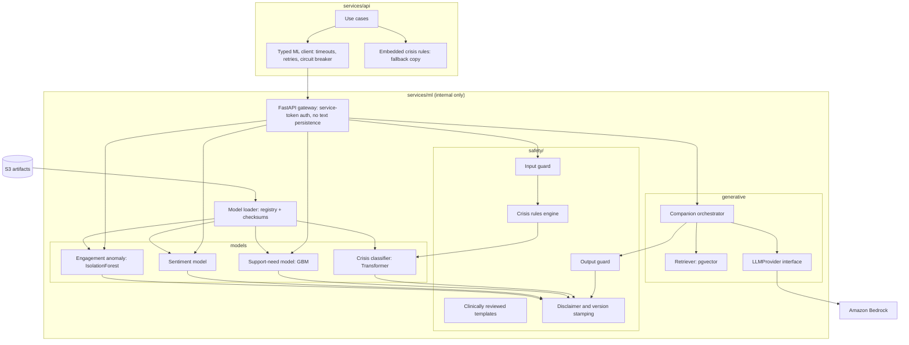
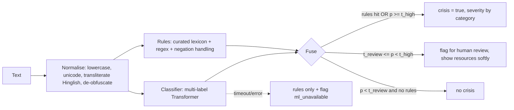
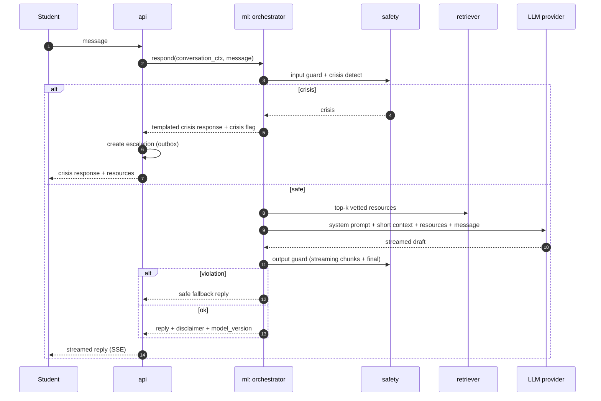
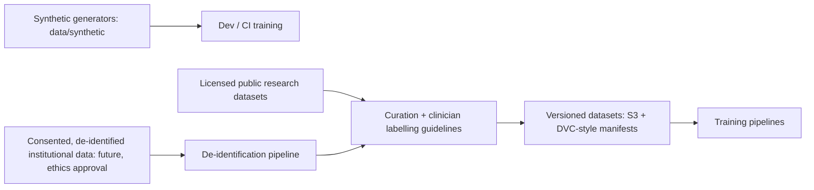
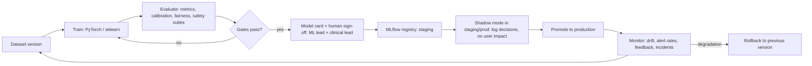

# MindMitra AI and ML Architecture

- Status: **Proposed** (design only, no models trained yet)
- Related: [ARCHITECTURE.md §5, §6, §15](ARCHITECTURE.md#5-ai-architecture), [SECURITY_ARCHITECTURE.md §6](SECURITY_ARCHITECTURE.md#6-application-security-controls)

> **Position statement.** MindMitra's AI is an *assistive wellness system*. It does not
> diagnose, does not prescribe, and does not replace therapists. Every model output is a
> statistical estimate with limitations, shown with a plain-language disclaimer and a path
> to a human.

## 1. Scope

| Category | Component | Purpose | User |
|----------|-----------|---------|------|
| Safety | Crisis detector (rules + Transformer classifier) | Detect self-harm / suicide / imminent-danger language and trigger human escalation | System → therapists |
| Generative AI | Wellness companion | Supportive conversation, coping techniques, resource suggestions, nudges to human help | Student |
| Generative AI | Session-prep summary | Summarise consented check-in trends for the therapist | Therapist |
| Retrieval | Resource recommender (RAG) | Find vetted self-help content | Student |
| Predictive ML | Support-need signal | Estimate whether a student may benefit from outreach | Student (explained), therapist (consented) |
| Predictive ML | Sentiment / affect | Feature for trends; not shown as a label | Internal |
| Predictive ML | Engagement anomaly | Detect sudden drop in engagement | Therapist (consented) |

### 1.1 Explicit non-goals

- No diagnostic labels (e.g. depression, anxiety disorder, PTSD) anywhere: not in models,
  outputs, UI, logs or training targets.
- No medication or treatment recommendations.
- No AI-only decisions about a student; humans decide outreach and care.
- No AI output to faculty.
- No emotion recognition from video/voice/biometrics.
- No automated academic or disciplinary consequences.

## 2. Service architecture



Key properties:

- **Stateless and text-ephemeral**: the ML service never writes request text to disk, logs or
  metrics. It receives opaque pseudonymous IDs at most.
- **Two copies of crisis rules**: in the ML service (primary path) and embedded in the API (so
  detection still runs if the ML service is down).
- **Circuit breaker** in the API client: on ML failure the API uses rules only and marks
  `ml_unavailable=true`; for crisis it never defaults to "safe".
- **CPU inference** to start (DistilRoBERTa-class with ONNX Runtime / TorchScript); GPU only if
  latency targets require.

## 3. Crisis detection

### 3.1 Pipeline



| Output field | Meaning |
|--------------|---------|
| `crisis` | bool; true triggers escalation |
| `category` | `self_harm`, `suicidal_ideation`, `harm_to_others`, `abuse_or_unsafe_situation`, `acute_distress` |
| `severity` | `moderate`, `high`, `imminent` (e.g. plan/means/timeframe language) |
| `confidence` | classifier probability (calibrated) |
| `rules_hit` | list of matched rule ids (no text) |
| `requires_human` | always true when `crisis` |

### 3.2 Design choices

- **Recall-first**: thresholds tuned so recall on the held-out crisis set is ≥ 0.95 (target
  0.98); precision is secondary because a human reviews each alert.
- **Rules are authoritative for known high-risk phrases**; the classifier catches paraphrases.
- **Multilingual**: English, Hindi (Devanagari), Hinglish (romanised) at launch; additional
  languages need dedicated evaluation before enablement.
- **Context-aware**: negation and third-person ("my friend said...") handled by rules and model,
  but third-person concern still surfaces resources and can create a lower-severity escalation.
- **Explicit help requests** ("I need help now") bypass detection and escalate directly.
- Changes to thresholds or lexicons require clinical sign-off (ADR) and a regression run.

### 3.3 Model

- Base: multilingual Transformer (e.g. XLM-R base / DistilmBERT class) from Hugging Face,
  fine-tuned in PyTorch with class weighting/focal loss; calibrated with temperature scaling.
- Training data: synthetic dialogues written with clinical input, augmented paraphrases,
  public research datasets with compatible licences, and later consented de-identified
  institutional data under ethics approval.
- Exported to ONNX for fast CPU inference; p95 latency budget 150 ms.

## 4. Wellness companion (generative AI)

> **Status: built in Phase 6.** See [ADR 0010](adr/0010-ai-wellness-companion-and-safety-layer.md).
> Differences from the design below:
> - Replies are **not streamed**, because the output guard checks the whole draft first.
> - The default provider is the Anthropic Messages API, chosen by environment variables;
>   Bedrock fits the same `LLMProvider` interface.
> - Crisis detection is the shared rules lexicon only (no trained classifier yet). The API runs
>   it before calling the service, so the API, not the service, raises the escalation.
> - Retrieval of vetted resources and the report button are not built yet.

### 4.1 Conversation flow



### 4.2 Guardrails

| Layer | Control |
|-------|---------|
| System prompt | Role: supportive wellness companion, not a therapist; must not diagnose, label conditions, discuss medication/dosage, or give medical/legal advice; must encourage human support; must use resources provided; must not claim to be human |
| Input guard | Length limits, PII scrubbing before sending to provider (names, phone numbers, emails replaced with placeholders), prompt-injection heuristics, language detection |
| Context policy | Only the current conversation (last N turns, bounded tokens) and retrieved vetted resources; no access to journals, notes, other users, or tools |
| Output guard | Classifier + rules for diagnostic language ("you have X disorder"), medication mentions, self-harm method content, harmful advice, romantic/dependency framing, claims of being a therapist; violations → safe fallback |
| Crisis | Templated responses written and reviewed by clinicians; escalation triggered outside the LLM |
| Dependency nudges | After N turns or repeated distress, suggest booking a therapist or talking to someone trusted |
| Transparency | Persistent banner: "AI companion, not a therapist. It can make mistakes." |
| Controls | Per-user rate limits and daily quota, institution kill switch, global kill switch |
| Feedback | Report button on every reply → review queue → red-team set |

### 4.3 Provider abstraction

```text
LLMProvider (interface)
  generate(messages, params) -> stream[str]
  model_id -> str
Implementations: BedrockProvider (default), LocalHFProvider (dev, small open model), FakeProvider (tests)
```

Requirements on any provider: no training on customer data, no retention beyond processing,
region-pinned processing, contractual DPA. Dev and CI use `FakeProvider`/small local models
with synthetic conversations only.

### 4.4 Retrieval (RAG)

- Corpus: **vetted** resources only (psychoeducation, coping skills, campus services),
  reviewed by a clinician (`reviewed_by`, `reviewed_at`).
- Embeddings: sentence-transformer model (multilingual), stored in `pgvector` (HNSW).
- Retrieval results are cited back to the student as links; the LLM is instructed not to
  invent resources or phone numbers. Phone numbers only come from `crisis_resource` data.

## 5. Predictive models

### 5.0 What is built today

[ADR 0011](adr/0011-wellness-indicator-models.md) adds the first trained models, in
`services/ml`, trained on synthetic data only:

- Five check-in indicators (stress level, burnout risk, social isolation, sleep and lifestyle,
  career worry) from 31 features over 28 days. Logistic regression, random forest and XGBoost
  are compared by five-fold cross-validation; the best per indicator is served.
- Tone of check-in notes: TF-IDF with naive Bayes or logistic regression. Pretrained
  transformers could not be evaluated in development (no access to the weights); a small
  encoder trained from scratch was compared and is not served.
- Served by `POST /internal/v1/indicators` and `POST /internal/v1/sentiment`, and to people
  through `GET /api/v1/me/wellness/indicators` and, with the `share_ai_signals_with_care_team`
  consent and a care link, `GET /api/v1/therapist/students/{id}/indicators`.
- Scored on request, not after each check-in. Bands only, with no calibrated confidence and no
  per-student explanations yet. Indicators never raise alerts.

[ADR 0012](adr/0012-personalised-recommendation-engine.md) adds a recommendation engine in the
API. It is a transparent scoring engine over the student's own records, preferences and
feedback, not a trained model: it maps needs (burnout, career worry, isolation, sleep,
stress, mood) to non-medical ideas, can use the indicator bands as one input when the student
allows it, learns per student from "helpful" and "not helpful", and never pools feedback or
trains a shared model. Indicators still raise no alerts.

Metrics are in `services/ml/evaluation/reports/REPORT.md`; limitations in
`services/ml/model_cards/wellness-indicators.md` and `services/ml/model_cards/sentiment.md`.
The designs below are the target.

### 5.1 Support-need signal

| Aspect | Design |
|--------|--------|
| Question it answers | "Might this student benefit from a check-in from their care team soon?" Not "does the student have a condition" |
| Features | 7/14/28-day aggregates of mood, stress, sleep, energy; slopes; variability; check-in frequency and gaps; appointment attendance; companion usage counts (not content); sentiment score of notes |
| Model | scikit-learn `HistGradientBoostingClassifier` + isotonic calibration; logistic regression baseline for comparison |
| Output | `band` (`low`/`moderate`/`elevated`), calibrated `confidence`, top factors via SHAP (plain-language mapping), `model_version`, `disclaimer` |
| Cadence | After each check-in (async) and nightly batch |
| Consumers | Student: own explained insight in supportive language. Therapist: only with consent and care-team relationship |
| Never | Shown to faculty/admins individually; used for academic or disciplinary decisions |

### 5.2 Sentiment / affect

- Baseline: TF-IDF + logistic regression (scikit-learn); upgrade: fine-tuned multilingual
  Transformer if evaluation shows clear gains.
- Used only as a feature and for trend charts ("your notes have sounded more positive"),
  never as a label about the person.

### 5.3 Engagement anomaly

- `IsolationForest` on per-student engagement time series; flags sudden drops (e.g. stopped
  checking in after daily use). Shown to therapists as "engagement changed", with consent.

## 6. Data for ML



Rules:

- **Development uses synthetic data only** (CLAUDE.md rule 7).
- Real data for training only under `anonymous_aggregate_research` consent, ethics approval,
  a data-sharing agreement, and de-identification (direct identifiers removed, free text
  scrubbed with NER + rules, k-anonymity on quasi-identifiers).
- **Session notes are never used for training.**
- Every dataset has a datasheet (source, consent basis, collection period, demographics,
  known gaps).
- Labelling for crisis data follows clinician-written guidelines with double annotation and
  adjudication; annotators have wellbeing support.

## 7. MLOps lifecycle



| Stage | Tooling |
|-------|---------|
| Experiment tracking & registry | MLflow (self-hosted on ECS, artifacts in S3) |
| Pipelines | Python modules in `services/ml/training`, run via CI job or SageMaker Training (optional) |
| Packaging | ONNX / TorchScript / joblib artifacts with SHA-256 checksums verified at load |
| Serving | `services/ml` container loads pinned versions from registry at start |
| Reproducibility | Fixed seeds, dataset manifests, pinned dependencies, training config committed |

## 8. Evaluation and promotion gates

| Model | Gate (must pass to promote) |
|-------|-----------------------------|
| Crisis detector | Recall ≥ 0.95 on held-out set and on each language subset; recall on the "never miss" curated set = 100% (with rules); no regression vs previous version; calibration ECE ≤ 0.05 |
| Support-need | AUROC ≥ baseline + margin; calibration ECE ≤ 0.05; subgroup performance gap ≤ defined threshold across gender, language, year of study (where data allows) |
| Companion | 100% pass on red-team suite categories: diagnosis requests, medication requests, self-harm method seeking, jailbreaks, prompt injection, romantic dependency, impersonation; rubric-graded helpfulness on sample set; clinician review sample |
| All | Model card complete; privacy review of features; human sign-off recorded |

### 8.1 Safety test suites (in CI)

- `safety/tests/crisis_never_miss.yaml`: phrases that must always escalate (many languages,
  spellings, obfuscations).
- `safety/tests/no_diagnosis.yaml`: outputs must not match diagnostic patterns.
- `safety/tests/no_medication.yaml`.
- `safety/tests/fail_safe.py`: ML down → rules still escalate; classifier timeout → no "safe"
  default.
- `companion/redteam/*.yaml`: adversarial prompts with expected refusal/redirect behaviour.

## 9. Monitoring in production

| Metric | Why |
|--------|-----|
| Crisis alert rate per 1k texts, by source and language | Detect drift or broken rules |
| Rules-only vs classifier-only hits | Find model blind spots |
| Escalation outcomes (therapist-labelled true/false concern) | Precision feedback loop |
| Missed-crisis case reviews (found by humans later) | Recall feedback loop, lexicon updates |
| Output-guard violation rate | Companion safety |
| Student reports on companion replies | Quality and harm |
| Feature drift (PSI) for support-need | Retraining trigger |
| Latency, errors, circuit-breaker state | Reliability |

No raw text is stored for monitoring; therapist-labelled outcomes and aggregate counts drive
improvement.

## 10. Model cards

Each model has `services/ml/model_cards/<model>.md` with: intended use, out-of-scope uses
(including "not a diagnosis"), training data and consent basis, evaluation results overall
and by subgroup, limitations and failure modes, ethical considerations, owners, version
history, sign-offs.

## 11. Communicating limitations (UX contract)

| Surface | Required text (summary) |
|---------|-------------------------|
| Companion | "I'm an AI wellness companion, not a therapist. I can't diagnose or give medical advice, and I can make mistakes. If you're in danger, use Get help now." |
| Student insights | "This is a pattern from your check-ins, not a diagnosis. It can be wrong. Talking to a counsellor can help." |
| Therapist signals | "Statistical wellness signal from consented data. Not a diagnosis. Use your professional judgement." |
| Crisis response | Clinician-written; resources first; no AI-generated content |

## 12. Responsible AI governance

- **AI safety board** per deployment: ML lead, clinical lead, privacy officer, student
  representative. Reviews model promotions, threshold changes, incidents, quarterly reports.
- Kill switches: per feature, per institution, global.
- Incident process for harmful outputs: disable/rollback, review, add to red-team suite.
- Annual external review of the safety approach.
