# MindMitra Technical Architecture

- Status: **Proposed** (Phase 0, architecture design). Not yet implemented.
- Owner: Bhavya
- Changes require an ADR in [`docs/adr/`](adr/) (CLAUDE.md rule 1).

Companion documents:

| Document | Covers |
|----------|--------|
| [DATABASE_DESIGN.md](DATABASE_DESIGN.md) | Schemas, tables, ER diagrams, encryption, row-level security, retention |
| [API_DESIGN.md](API_DESIGN.md) | REST conventions, endpoint catalogue, authorization per endpoint, WebSocket events |
| [SECURITY_ARCHITECTURE.md](SECURITY_ARCHITECTURE.md) | Threat model, authentication, RBAC/ABAC, encryption, audit, compliance |
| [AI_ML_ARCHITECTURE.md](AI_ML_ARCHITECTURE.md) | AI companion, ML models, safety layer, MLOps, evaluation |
| [USER_FLOWS.md](USER_FLOWS.md) | End-to-end flows for each role, including crisis support |
| [../DEVELOPMENT_ROADMAP.md](../DEVELOPMENT_ROADMAP.md) | Phase-by-phase delivery plan |

---

## Contents

1. [High-level system architecture](#1-high-level-system-architecture)
2. [Frontend architecture](#2-frontend-architecture)
3. [Backend architecture](#3-backend-architecture)
4. [Database architecture](#4-database-architecture)
5. [AI architecture](#5-ai-architecture)
6. [ML architecture](#6-ml-architecture)
7. [Authentication architecture](#7-authentication-architecture)
8. [RBAC architecture](#8-rbac-architecture)
9. [Therapist/student communication architecture](#9-therapiststudent-communication-architecture)
10. [Notification architecture](#10-notification-architecture)
11. [Analytics architecture](#11-analytics-architecture)
12. [Security architecture](#12-security-architecture)
13. [AWS deployment architecture](#13-aws-deployment-architecture)
14. [Data flow architecture](#14-data-flow-architecture)
15. [Crisis-support workflow](#15-crisis-support-workflow)
16. [Privacy and consent architecture](#16-privacy-and-consent-architecture)
17. [Architectural risks and mitigations](#17-architectural-risks-and-mitigations)
18. [Open decisions](#18-open-decisions)

---

## 0. Requirements analysis

### 0.1 Product goals

1. Give students a private, stigma-free place to track wellbeing and get support early.
2. Connect students to human help (therapists, counselling team) quickly, especially in a crisis.
3. Give therapists better tools: caseload, scheduling, secure messaging, confidential notes,
   consented wellbeing trends and assistive AI signals.
4. Let faculty raise concerns safely and see only privacy-preserving aggregate insight.
5. Let administrators run the platform for an institution without seeing clinical content.

### 0.2 Functional requirements by role

| Role | Key capabilities |
|------|------------------|
| Student | Onboarding and consent, daily check-ins, private journal, AI wellness companion, self-help resource library, book/reschedule/cancel appointments, secure messaging with assigned therapist, "Get help now", view own insights, export/delete own data |
| Therapist | Caseload, availability and calendar, appointments, secure messaging, confidential session notes, consented check-in trends, AI support-need signals, crisis escalation queue, referral triage, handoff to colleagues |
| Teacher/Faculty | Submit concern referral, see referral status only, cohort-level aggregate wellbeing trends (k-anonymised), wellbeing resources and guidance |
| Administrator | Institution setup, user lifecycle (invite, deactivate), role and therapist assignment, on-call rota, crisis resources config, audit log, system health, institution-level aggregate analytics |

### 0.3 Non-functional requirements

| Category | Target |
|----------|--------|
| Availability | 99.9% for core API; **crisis path (help page + escalation creation) 99.95%** with degraded-mode fallbacks |
| Latency | p95 < 300 ms for standard API calls; crisis detection on submitted text < 1 s; companion first token < 2 s |
| Scale (initial) | 10 institutions, 50k students, 500 therapists, ~5k concurrent users; design to scale horizontally 10× |
| Privacy | Least privilege, consent-driven sharing, field-level encryption for sensitive and clinical text, full audit |
| Security | OWASP ASVS L2 baseline, L3 controls for clinical data |
| Accessibility | WCAG 2.1 AA |
| Maintainability | Clean architecture, typed code, ≥ 80% coverage on domain/application layers, 100% of endpoints in the authorization matrix |
| Data residency | Single AWS region per deployment (e.g. `ap-south-1` for India); configurable |

### 0.4 Key constraints

- AI is assistive; it never diagnoses, prescribes, or replaces therapists.
- Crisis indicators always lead to human escalation, independent of ML availability.
- Teachers never see therapy or individual clinical data.
- Development uses synthetic data only.

---

## 1. High-level system architecture

MindMitra is a **modular monorepo** with three deployable applications plus background
workers, backed by PostgreSQL, Redis and S3, running on AWS.

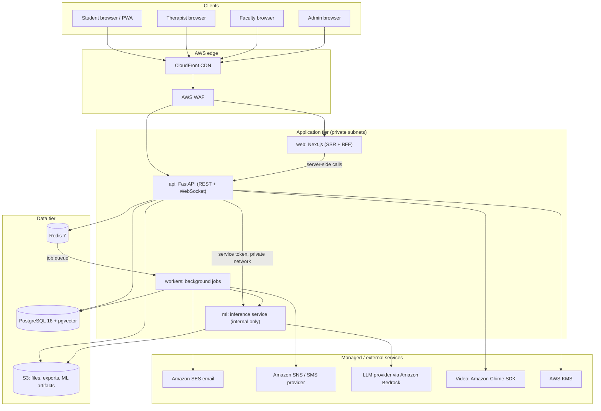

### 1.1 Deployable units

| Unit | Responsibility | Scales on |
|------|---------------|-----------|
| `apps/web` | UI for four roles, SSR, thin backend-for-frontend (cookie handling, API proxy) | Request rate |
| `services/api` | Authentication, authorization, domain logic, REST + WebSocket, audit, escalation orchestration | Request rate, WS connections |
| `services/api` (worker mode) | Notifications, escalation timers, ML batch scoring, exports, retention jobs, analytics aggregation | Queue depth |
| `services/ml` | Crisis detection, sentiment, support-need signals, companion orchestration with guardrails | Inference latency/CPU |

### 1.2 Architectural style

- **Clean architecture** inside each Python service: `api → application → domain`;
  `infrastructure` implements domain interfaces.
- **Modular monolith** for the API: bounded contexts as packages with explicit interfaces, so
  any of them can be extracted later without a rewrite.
- **Event-driven side effects** via a transactional outbox (no lost notifications or
  escalations if a process crashes after commit).
- **Multi-tenant** by `institution_id` with PostgreSQL row-level security as defence in depth.

### 1.3 Bounded contexts (API modules)

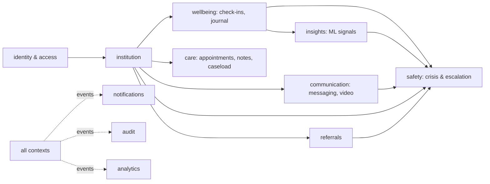

Each context owns its tables, application services and policies. Contexts communicate through
application-service interfaces or domain events, never by reading each other's tables directly.

---

## 2. Frontend architecture

### 2.1 Stack

Next.js (App Router) · React · TypeScript `strict` · Tailwind CSS · shadcn/ui (Radix) ·
TanStack Query · React Hook Form + Zod · next-intl (i18n-ready) · Vitest + Testing Library ·
Playwright.

### 2.2 Structure

```
apps/web/src/
  app/
    (public)/            landing, login, invite acceptance, /help (crisis resources, static, no auth)
    (student)/student/   dashboard, check-in, journal, companion, resources, appointments, messages, privacy
    (therapist)/therapist/ caseload, calendar, sessions/[id], notes, messages, escalations, referrals
    (faculty)/faculty/   referrals/new, referrals, insights, resources
    (admin)/admin/       users, assignments, on-call, crisis-config, audit, analytics, settings
    api/                 BFF route handlers (auth cookie exchange only)
    layout.tsx, middleware.ts
  components/
    ui/                  shadcn/ui primitives (generated)
    shared/              AppShell, DisclaimerBanner, GetHelpButton, EmptyState, DataTable
    features/            per-feature components (checkin/, journal/, companion/, ...)
  lib/
    api/                 generated typed client from OpenAPI + fetch wrapper
    auth/                session helpers, role guards
    realtime/            WebSocket client with reconnect
    validation/          Zod schemas shared with forms
  hooks/, styles/, i18n/
tests/ unit/ e2e/
```

### 2.3 Rendering and data strategy

| Concern | Approach |
|---------|----------|
| Rendering | Server Components by default; Client Components for forms, charts, chat, realtime |
| Data fetching | Server Components call the API server-side with the user's cookie; client-side uses TanStack Query against the same API |
| API contract | `packages/contracts/openapi.json` exported by CI → generated TS types and client; no hand-written request types |
| State | Server state in TanStack Query; local UI state in React; no global store unless needed |
| Realtime | One authenticated WebSocket per tab for messages, notifications and escalation alerts |
| Caching | No caching of sensitive pages at CDN (`Cache-Control: private, no-store`); static assets and `/help` cached |
| Forms | React Hook Form + Zod schemas mirrored from OpenAPI |
| Errors | Error boundaries per route group; crisis help link always rendered even in error states |

### 2.4 Routing and guards

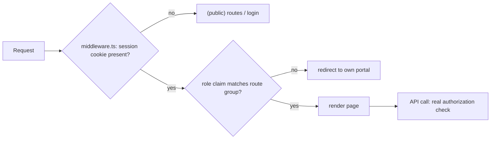

Frontend guards are UX only. **The API is the single enforcement point** for authorization.

### 2.5 Safety and UX rules

- A persistent `GetHelpButton` on every authenticated student page and the public `/help`
  page, which works without JavaScript and without login.
- `DisclaimerBanner` on every AI surface ("AI support tool, not a diagnosis or therapy").
- Calm visual language, no red alarm colours for ML signals, plain-language explanations.
- WCAG 2.1 AA, keyboard navigation, reduced motion, screen-reader-tested chat.
- No sensitive data in `localStorage`, URLs, analytics events or error reports.

---

## 3. Backend architecture

### 3.1 Stack

Python 3.12 · FastAPI · Pydantic v2 · SQLAlchemy 2 (async) · asyncpg · Alembic · Redis ·
ARQ (proposed) for jobs · httpx · structlog · OpenTelemetry · pytest.

### 3.2 Layered structure

```
services/api/app/
  main.py                    app factory, middleware, router registration
  core/                      settings, security (JWT, password hashing), logging, errors, telemetry
  api/
    deps.py                  get_db, get_current_user, require_permission, rate_limit
    v1/
      auth.py users.py institutions.py checkins.py journal.py companion.py
      appointments.py notes.py messages.py referrals.py escalations.py
      insights.py notifications.py analytics.py admin.py consent.py privacy.py
    ws.py                    WebSocket gateway
  application/               use cases (one class/function per use case), DTOs, unit of work
  domain/
    <context>/entities.py value_objects.py events.py repositories.py (interfaces)
    policies/                authorization policies (pure functions)
  infrastructure/
    db/                      SQLAlchemy models, repositories, RLS session setup
    cache/                   Redis client, rate limiter, idempotency
    crypto/                  envelope encryption (KMS), blind indexes
    ml_client/               typed client for services/ml
    messaging/               SES, SNS, web push adapters
    storage/                 S3 adapter
    outbox/                  outbox writer + relay
  workers/                   ARQ worker settings and job functions
```

### 3.3 Request lifecycle

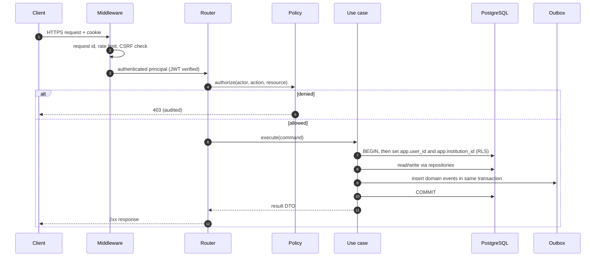

### 3.4 Cross-cutting concerns

| Concern | Implementation |
|---------|----------------|
| Configuration | `pydantic-settings`, env vars only, validated at startup |
| Authorization | `require_permission` dependency + resource policy in every router; CI fails if a route lacks it |
| Transactions | Unit of Work per request; RLS session variables set at transaction start |
| Side effects | Transactional outbox → relay → Redis queue → workers (at-least-once, idempotent handlers) |
| Idempotency | `Idempotency-Key` header on POSTs that create escalations, appointments, messages |
| Rate limiting | Redis sliding window per user/IP/route class |
| Validation | Pydantic v2 models, strict mode for inputs |
| Errors | RFC 9457 problem+json, no stack traces or data in responses |
| Logging | structlog JSON, request id, actor id, no bodies or PII |
| Observability | OpenTelemetry traces and metrics, health and readiness probes |
| API versioning | `/api/v1`, additive changes only within a version |

### 3.5 Background jobs

| Job | Trigger | Notes |
|-----|---------|-------|
| `deliver_notification` | outbox event | Channel fan-out, retries with backoff |
| `escalation_ack_timer` | escalation created | Re-escalates to backup if not acknowledged within SLA |
| `score_checkin` | check-in created | Calls ML; stores `ml_signal`; crisis already checked synchronously |
| `aggregate_analytics` | hourly/nightly cron | Builds k-anonymised aggregates |
| `retention_sweep` | nightly cron | Deletes/crypto-shreds expired data |
| `export_user_data` | student request | Builds encrypted export in S3, short-lived link |
| `appointment_reminders` | cron | Generic reminder text only |

---

## 4. Database architecture

Full detail in [DATABASE_DESIGN.md](DATABASE_DESIGN.md).

### 4.1 Stores

| Store | Use |
|-------|-----|
| PostgreSQL 16 (RDS, Multi-AZ) | System of record; `pgvector` for resource-library embeddings |
| Redis 7 (ElastiCache) | Rate limits, refresh-token denylist, WebSocket pub/sub, job queue, short-lived caches |
| S3 | Attachments, data exports, ML artifacts, backups (all SSE-KMS) |

### 4.2 Schema organisation

PostgreSQL schemas map to bounded contexts and sensitivity:

| Schema | Contents | Sensitivity |
|--------|----------|-------------|
| `iam` | users, credentials, sessions, roles, permissions, MFA | Personal / secret |
| `org` | institutions, departments, cohorts, profiles, assignments | Personal |
| `wellbeing` | check-ins, journal entries, companion conversations | Sensitive |
| `care` | appointments, availability, session notes, care team | Clinical-Confidential |
| `comm` | message threads, messages, video sessions | Sensitive |
| `safety` | crisis signals, escalations, on-call rota, crisis resources | Sensitive / Clinical |
| `insights` | ML signals, model versions | Sensitive |
| `consent` | consent records, policy versions | Personal |
| `notify` | notifications, preferences, delivery log, outbox | Internal |
| `audit` | append-only audit events | Restricted |
| `analytics` | aggregated, de-identified tables only | Internal |

### 4.3 Key decisions

- **UUIDv7 primary keys** (time-ordered, non-guessable).
- **`institution_id` on every tenant row** + **row-level security** policies keyed on
  session variables set per transaction.
- **Field-level envelope encryption** for free text in Sensitive and Clinical tables
  (journal bodies, messages, session notes, companion messages, referral notes).
- **Soft delete + retention jobs**; hard delete/crypto-shredding where retention expires or a
  student exercises deletion rights (subject to legal holds on clinical records).
- **Append-only audit** schema (no UPDATE/DELETE grants; hash-chained rows).
- **Analytics** schema receives only aggregated rows; no foreign keys back to individuals.

---

## 5. AI architecture

Full detail in [AI_ML_ARCHITECTURE.md](AI_ML_ARCHITECTURE.md).

"AI" in MindMitra means the **user-facing generative and assistive features**:

| Feature | Users | Purpose |
|---------|-------|---------|
| Wellness companion (chat) | Student | Supportive reflection, coping techniques from a vetted library, nudges toward human help |
| Resource recommendations (RAG) | Student | Retrieve relevant vetted self-help articles |
| Check-in reflections | Student | Plain-language summary of own trends with disclaimers |
| Session prep summary | Therapist | Summary of consented check-in trends since last session (never of journal/chat) |
| Note drafting assist (later, opt-in) | Therapist | Structure therapist-typed notes; therapist edits and owns the note |

### 5.1 Guardrailed AI pipeline

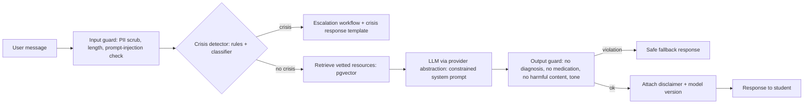

- **Provider abstraction** (`LLMProvider` interface) with Amazon Bedrock as the proposed
  default, so data stays in the AWS account and is not used for training. Swappable by ADR.
- **No AI output reaches a teacher** and no AI output is shown to a therapist as a clinical
  conclusion.
- **Crisis responses are templated**, not generated, so wording is clinically reviewed.

---

## 6. ML architecture

Full detail in [AI_ML_ARCHITECTURE.md](AI_ML_ARCHITECTURE.md).

"ML" means **predictive and classification models** trained and served by MindMitra:

| Model | Tech | Input | Output |
|-------|------|-------|--------|
| Crisis language classifier | Hugging Face Transformer (DistilRoBERTa-class) fine-tuned in PyTorch | Free text | `crisis_probability`, category; **always combined with deterministic rules** |
| Sentiment / affect | scikit-learn baseline (TF-IDF + LR) → Transformer | Check-in text | sentiment score |
| Support-need signal | scikit-learn gradient boosting (calibrated) | Check-in time series features | `low / moderate / elevated` band + top factors |
| Engagement anomaly | scikit-learn isolation forest | Usage patterns | "sudden drop in engagement" signal for therapist (consented) |

### 6.1 ML service layout

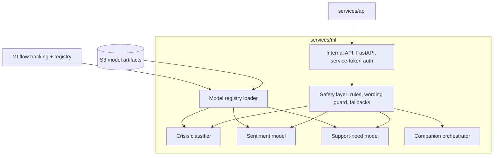

Training happens offline (`services/ml/training`) on synthetic or consented, de-identified
data; promotion requires passing evaluation gates (crisis recall floor, calibration, subgroup
fairness) and a human sign-off recorded in the model card.

---

## 7. Authentication architecture

Detail in [SECURITY_ARCHITECTURE.md §3](SECURITY_ARCHITECTURE.md#3-authentication).

| Aspect | Design |
|--------|--------|
| Identity source | MindMitra-managed accounts per institution (Phase 2); institution SSO via OIDC/SAML (Phase 9) |
| Onboarding | Invite-only for therapists, faculty, admins; students self-register with a verified institutional email domain or via bulk invite |
| Passwords | Argon2id, breached-password check (k-anonymity range API or local list), min length 12 |
| MFA | TOTP required for therapists and admins; optional for students and faculty; WebAuthn later |
| Tokens | Access JWT (EdDSA, 10 min) + opaque rotating refresh token (7 days idle, 30 days absolute) stored hashed in DB |
| Transport | `__Host-` prefixed httpOnly, Secure, SameSite=Lax cookies; CSRF double-submit token for unsafe methods |
| Reuse detection | Refresh-token families: reuse of a rotated token revokes the whole family |
| Session control | Users can view/revoke sessions; admins can force logout; password change revokes all |
| Step-up auth | Re-authentication (password + MFA) to view session notes in bulk, export data, change roles |

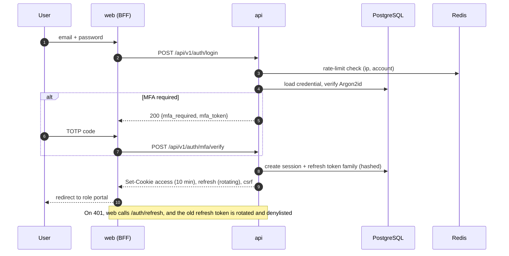

---

## 8. RBAC architecture

Detail in [SECURITY_ARCHITECTURE.md §4](SECURITY_ARCHITECTURE.md#4-authorization-rbac--abac).

Authorization is **RBAC + ABAC**, decided in one place (`domain/policies`):

1. **Tenant check**: actor and resource share `institution_id` (also enforced by RLS).
2. **Role permission**: role grants a permission such as `checkin:read`.
3. **Relationship**: e.g. therapist is in the student's active care team.
4. **Consent**: e.g. student granted `share_checkins_with_care_team`.
5. **Purpose / break-glass**: crisis access grants time-boxed, audited extra visibility.

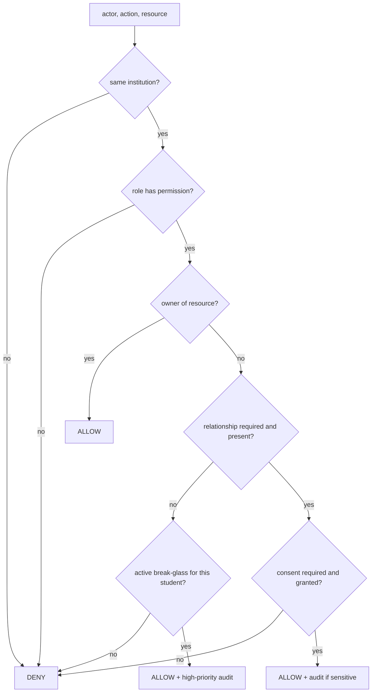

### 8.1 Roles

| Role | Scope |
|------|-------|
| `student` | Own data |
| `therapist` | Students in active care-team assignments |
| `clinical_supervisor` (therapist sub-role) | Therapists they supervise, per institution policy |
| `faculty` | Own referrals, cohort aggregates for cohorts they teach |
| `institution_admin` | Institution configuration and user management, no clinical content |
| `platform_admin` | Cross-institution operations (support, provisioning), no clinical content, heavily audited |

### 8.2 Permission matrix (summary)

| Permission | Student | Therapist | Faculty | Inst. admin |
|-----------|:------:|:---------:|:-------:|:-----------:|
| `checkin:create` | own | – | – | – |
| `checkin:read` | own | care team + consent | – | – |
| `journal:read` | own | only entries student explicitly shares | – | – |
| `companion:use` | own | – | – | – |
| `session_note:write/read` | – | author (+ supervisor) | – | – |
| `message:send/read` | with own care team | with own caseload | – | – |
| `appointment:manage` | own | own | – | metadata only |
| `referral:create` | – | yes | yes | – |
| `referral:read` | own (policy) | triage team | own, status only | metadata |
| `escalation:handle` | – | on-call + care team | – | metadata only |
| `ml_signal:read` | own (explained) | care team + consent | – | – |
| `analytics:aggregate` | – | caseload aggregates | own cohorts (k≥10) | institution (k≥10) |
| `user:manage` | – | – | – | yes |
| `audit:read` | own access history | – | – | yes |

The full matrix is the source for the **authorization test matrix** (every endpoint × every role).

---

## 9. Therapist/student communication architecture

### 9.1 Channels

| Channel | Mode | Design |
|---------|------|--------|
| Secure messaging | Async, with realtime delivery | Threads between a student and their care team; E2E-in-transit TLS + field-level encryption at rest; attachments in S3 (scanned, encrypted) |
| Appointments | Scheduling | Therapist availability slots, student booking, reschedule/cancel rules, reminders |
| Video sessions | Realtime | Amazon Chime SDK meetings created per appointment; API issues short-lived join tokens; no recording by default |
| In-app presence | Realtime | Limited to "therapist online/offline" for urgent chat routing; students' presence never exposed |

### 9.2 Messaging design

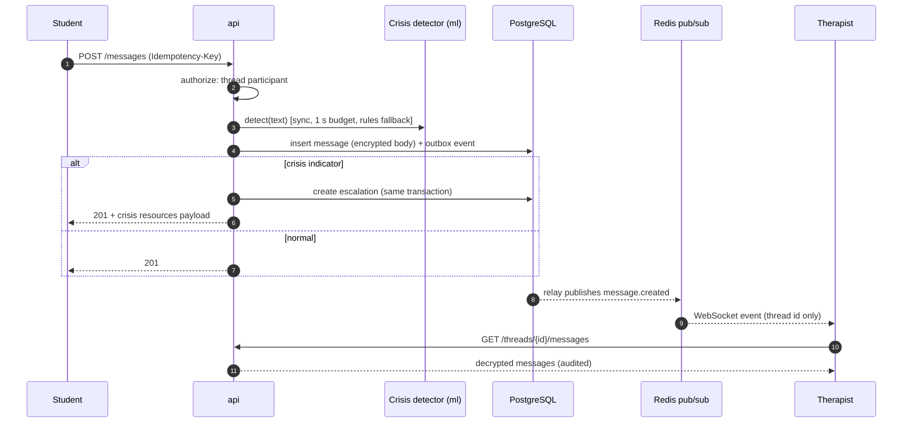

Rules:

- Threads exist only between a student and therapists in their active care team.
- Messaging is **not** an emergency channel: UI states expected response times and links to
  "Get help now"; every inbound student message still runs crisis detection.
- Off-hours auto-reply with crisis resources, based on therapist availability settings.
- WebSocket payloads carry IDs and event types only; content is fetched over authorized REST.
- Faculty and admins have no access to threads.

---

## 10. Notification architecture

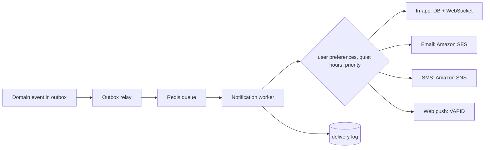

| Priority | Examples | Behaviour |
|----------|----------|-----------|
| `critical` | Crisis escalation to on-call therapist | All channels incl. SMS, ignores quiet hours, requires acknowledgement, re-escalates on timeout |
| `high` | Appointment in 1 hour, new message from therapist | In-app + push (+ email per preference) |
| `normal` | Referral status change, weekly reflection ready | In-app (+ email digest) |
| `low` | Product tips | In-app only, opt-in |

Privacy rules:

- **Content-free external notifications**: email/SMS/push say "You have a new update in
  MindMitra", never the content, diagnosis-like wording, or the word "crisis" to students.
- Therapist critical alerts include an escalation ID and severity only; details require login.
- Templates are versioned and reviewed; no free-text user content in templates.
- Delivery is idempotent (event id + channel), retried with exponential backoff, failures
  surfaced to admins.

---

## 11. Analytics architecture

Three distinct kinds of analytics with separate pipelines:

| Kind | Audience | Data | Protection |
|------|----------|------|-----------|
| Personal insights | Student (own), care team (consented) | Own check-ins, ML signals | RBAC + consent; computed on demand |
| Institutional wellbeing aggregates | Faculty (own cohorts), admins | Aggregated check-in metrics, escalation counts, service usage | k-anonymity (k ≥ 10), small-cell suppression, optional differential-privacy noise, no drill-down to individuals |
| Operational / product metrics | Admins, platform team | Response times, usage, errors | No content, pseudonymous IDs, no third-party trackers on authenticated pages |

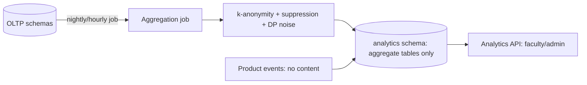

- The analytics API reads **only** the `analytics` schema; its DB role has no grants on OLTP
  schemas. This makes leaking individual data via analytics structurally hard.
- Faculty cohort views require the cohort size and every displayed cell to meet k ≥ 10; time
  windows are coarse (weekly) to resist differencing attacks.
- Self-hosted product analytics (e.g. PostHog self-hosted) may be added later by ADR;
  never on student wellbeing pages.

---

## 12. Security architecture

Detail in [SECURITY_ARCHITECTURE.md](SECURITY_ARCHITECTURE.md). Summary:

- **Defence in depth**: WAF → TLS → authentication → policy layer → RLS → field encryption →
  audit.
- **Encryption**: TLS 1.2+ everywhere; RDS/S3/ElastiCache encryption at rest with KMS;
  application-level envelope encryption with per-institution data keys for free text.
- **Secrets**: AWS Secrets Manager → ECS task env; `.env` locally; secret scanning in CI.
- **Audit**: append-only, hash-chained audit log for every Sensitive/Clinical access and every
  admin action; break-glass access alerts the clinical lead.
- **AppSec**: OWASP ASVS L2 baseline; SAST (Bandit, Semgrep, ESLint security), dependency
  scanning, container scanning (ECR/Trivy), DAST on staging, annual pentest.
- **Compliance-ready** design for DPDP Act (India), GDPR and FERPA principles; HIPAA-style
  safeguards for clinical notes. Legal review before production.

---

## 13. AWS deployment architecture

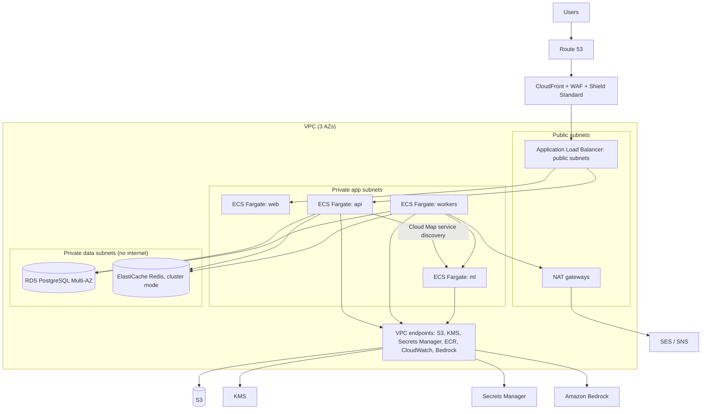

| Component | AWS service | Notes |
|-----------|-------------|-------|
| DNS / CDN / edge security | Route 53, CloudFront, WAF, Shield Standard | Managed rules + rate rules; geo restrictions optional |
| Containers | ECS on Fargate | Separate services and task roles per unit; autoscaling on CPU/queue depth |
| Images | ECR | Scan on push, immutable tags |
| Database | RDS PostgreSQL 16, Multi-AZ | Encrypted with CMK, automated backups (35 days), PITR, IAM auth for migrations |
| Cache/queue | ElastiCache Redis | TLS + AUTH, encryption at rest |
| Object storage | S3 | Block public access, SSE-KMS, versioning, lifecycle rules |
| Keys / secrets | KMS (per-environment CMKs), Secrets Manager | Automatic rotation where supported |
| LLM | Amazon Bedrock | Via VPC endpoint; model invocation logging disabled for content |
| Email / SMS | SES, SNS (or regional SMS provider) | Content-free templates |
| Video | Amazon Chime SDK | Meetings created on demand |
| Observability | CloudWatch Logs/Metrics, X-Ray via OpenTelemetry, Sentry (scrubbed) | Alarms to on-call |
| IaC | Terraform with remote state in S3 + DynamoDB lock | Per-environment workspaces |
| CI/CD | GitHub Actions with OIDC to AWS (no static keys) | Prod deploy needs manual approval |

Environments: `local` (docker-compose), `dev`, `staging`, `prod`, each in its own AWS account
(AWS Organizations) to limit blast radius. Only `prod` can hold real data.

**Disaster recovery**: RPO ≤ 5 min (PITR), RTO ≤ 1 h; cross-region encrypted snapshot copies;
quarterly restore drills. The static `/help` crisis page is served from CloudFront/S3 so it
stays available even if the application tier is down.

---

## 14. Data flow architecture

### 14.1 Daily check-in

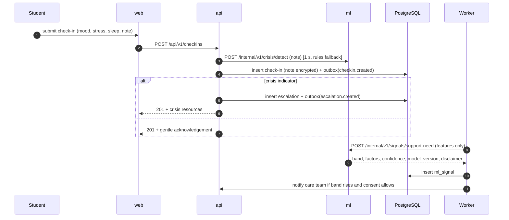

### 14.2 Data classification flow

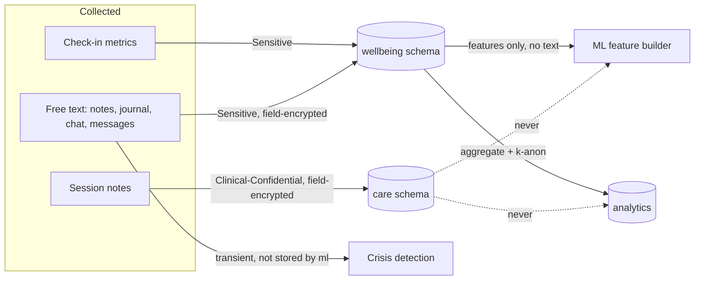

Principles: free text leaves the API only for transient inference in the ML service (which
does not persist it); clinical notes never feed analytics or ML training; analytics only ever
receives aggregates.

---

## 15. Crisis-support workflow

The crisis workflow is the most important path in the system. It is designed to be
**human-led, fail-safe and fast**.

### 15.1 Sources of crisis signals

1. Student presses **Get help now** (explicit).
2. Crisis detection on check-in notes, companion messages, therapist messages from students,
   and journal entries **only if** the student opted in to journal safety scanning.
3. Faculty referral marked "urgent concern for safety".
4. Therapist manually raises an escalation.

### 15.2 Workflow

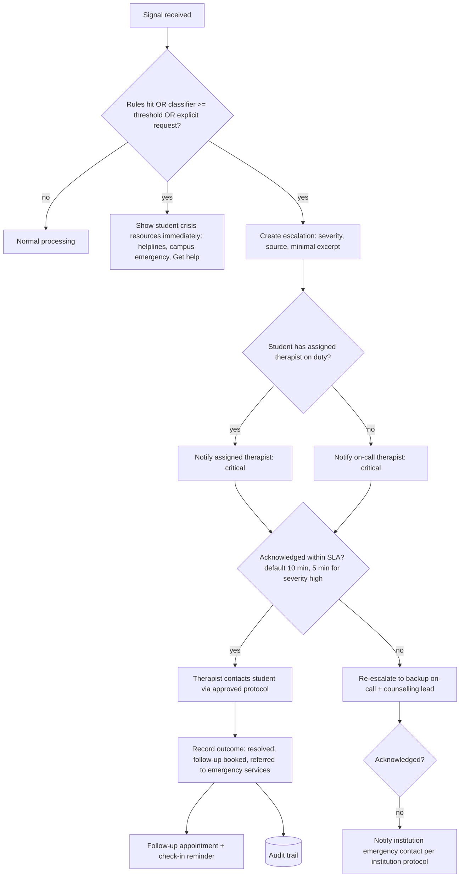

### 15.3 Escalation state machine

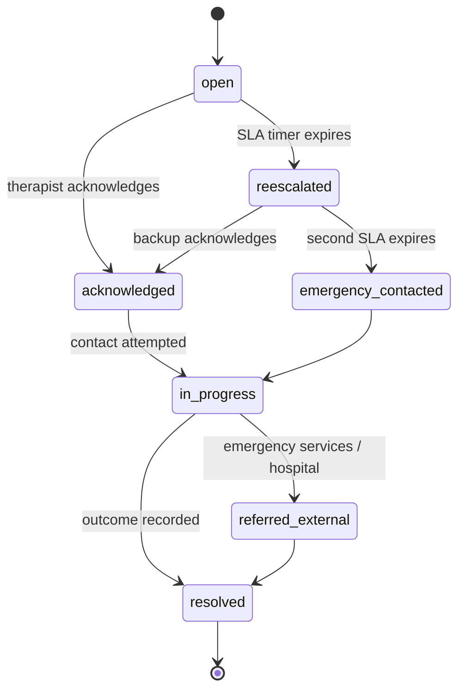

### 15.4 Guarantees

- **Fail-safe detection**: deterministic rules always run in the API process itself, so ML
  outages cannot suppress detection. Classifier timeouts default to "flag for human review"
  when rules are inconclusive but the text is long and negative-affect, never to "no risk".
- **Resources first**: the student sees resources before any human action, with no waiting.
- **No silent suppression**: thresholds can only be lowered in production without review;
  raising one needs a clinical sign-off ADR.
- **Minimal disclosure**: the escalation stores only the triggering excerpt (encrypted), not
  the whole journal or chat; break-glass access beyond that is time-boxed and audited.
- **Teachers** who raised a referral see only "received / being handled / closed".
- **Durability**: escalation creation is part of the same DB transaction as the triggering
  record; notifications use the outbox so a crash cannot drop them.
- **Monitoring**: alarms on unacknowledged critical escalations, notification failures, and
  crisis-detector errors page the platform on-call.
- **Clinical governance**: crisis wording, thresholds and protocols are owned by the
  institution's clinical lead and reviewed quarterly with false-negative case reviews.

---

## 16. Privacy and consent architecture

### 16.1 Principles

Privacy by design and by default; data minimisation; purpose limitation; transparency;
student control; security of processing; accountability (audit).

### 16.2 Consent model

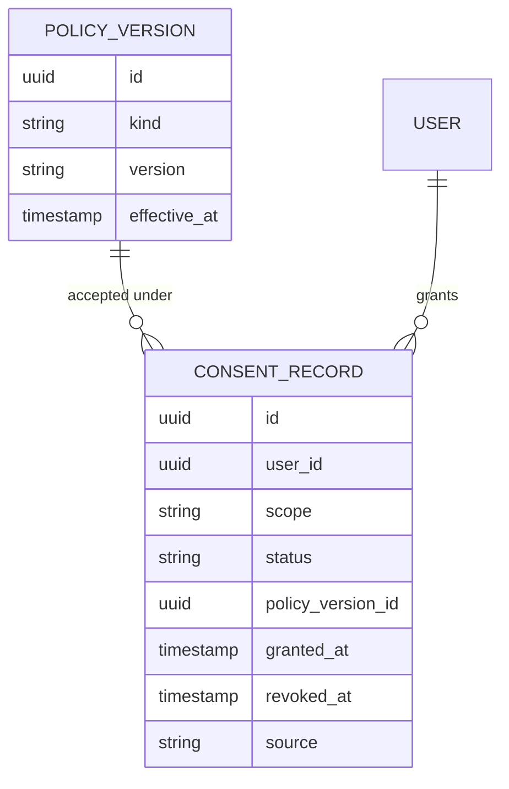

| Scope | Default | Effect |
|-------|---------|--------|
| `terms_and_privacy` | required | Account use |
| `share_checkins_with_care_team` | off, asked at first appointment | Therapist sees check-in metrics and trends |
| `share_ml_signals_with_care_team` | off | Therapist sees support-need signals |
| `journal_safety_scanning` | off | Journal entries run through crisis detection |
| `companion_history_retention` | 30 days | How long companion chats are kept (0, 30, 90 days) |
| `anonymous_aggregate_research` | off | De-identified data may be used for model improvement |
| `notification_channels` | in-app only | Email/SMS/push opt-in |

- Consent is **granular, explicit, revocable, versioned and recorded** (who, what, when, under
  which policy version). Revocation takes effect immediately in the policy layer.
- **Safety override**: crisis detection on check-in notes and companion messages is part of the
  service's duty of care and is disclosed clearly at onboarding (not a hidden consent).
  Journal scanning stays opt-in because journals are the most private space.

### 16.3 Data subject rights

| Right | Mechanism |
|-------|-----------|
| Access / portability | Self-service export (JSON + PDF) via async job, encrypted, 24 h link |
| Rectification | Edit profile and own entries |
| Erasure | Self-service deletion request: personal and wellbeing data crypto-shredded; clinical records retained only as legally required, then deleted |
| Transparency | "Who accessed my data" view from the audit log (role-level, e.g. "your therapist viewed your check-ins") |
| Withdraw consent | Privacy centre toggles, effective immediately |

### 16.4 Retention (defaults, institution-configurable within legal limits)

| Data | Default retention |
|------|-------------------|
| Companion chats | 30 days (student-selectable 0/30/90) |
| Check-ins | While enrolled + 1 year |
| Journal | Until student deletes or account closes |
| Messages | 3 years or per clinical records policy |
| Session notes | Per jurisdiction's clinical record rules (e.g. 7 years) |
| Escalations | Per clinical records policy |
| Audit logs | 7 years, immutable |
| Raw product events | 90 days; aggregates indefinitely |

### 16.5 Synthetic data

All non-production environments use synthetic data from `data/synthetic` generators.
Production snapshots are never restored into lower environments.

---

## 17. Architectural risks and mitigations

| # | Risk | Impact | Likelihood | Mitigation |
|---|------|--------|-----------|------------|
| R1 | **Crisis false negatives** (classifier misses risk) | Critical | Medium | Rules always run; recall-first thresholds; explicit "Get help" path everywhere; human review of misses; recall floor gate on model promotion; therapists never rely on ML alone |
| R2 | **Crisis alert not acted on** (no therapist available, off-hours) | Critical | Medium | On-call rota required before institution go-live; SLA timers with multi-level re-escalation; SMS critical channel; off-hours auto-response with helplines; alarms on unacknowledged escalations |
| R3 | **Teacher or admin sees clinical data** through a bug | Critical | Low–Med | Single policy layer; RLS defence in depth; analytics on separate schema/DB role; authorization matrix tests in CI; field encryption so raw DB access is not enough |
| R4 | **Re-identification from aggregates** (small cohorts, differencing) | High | Medium | k ≥ 10, small-cell suppression, coarse time windows, optional DP noise, no ad-hoc queries |
| R5 | **LLM harmful or diagnostic output** | High | Medium | Templated crisis responses; output guard; constrained prompts; red-team suite in CI; disclaimers; easy report button; kill switch per institution |
| R6 | **Prompt injection / data exfiltration via companion** | High | Medium | Companion has no tools or DB access; context limited to the student's own session and vetted resources; input guard; output PII scrub |
| R7 | **Over-reliance on AI** by students or therapists | High | Medium | UX nudges to human support; signals shown as bands with factors, never diagnoses; therapist training material; model cards visible |
| R8 | **Model bias** across gender, language, region, culture | High | Medium | Subgroup evaluation gates; multilingual and culturally diverse synthetic and consented data; Indian-English and Hinglish test sets; periodic audits |
| R9 | **Lack of real training data** (synthetic-only dev) | Medium | High | Start with rules + conservative baselines; partner with institutions for consented, de-identified datasets under ethics approval; public research datasets with compatible licences |
| R10 | **Key management failure** (lost KMS key = lost data; leaked key = breach) | Critical | Low | KMS CMKs with deletion protection and waiting period; per-institution data keys; key rotation; least-privilege key policies; backup and restore drills |
| R11 | **Regulatory mismatch** (DPDP/GDPR/FERPA/clinical record laws) | High | Medium | Region-pinned deployments; configurable retention; DPIA before launch; legal review; data processing agreements with LLM/SMS vendors |
| R12 | **Scope creep / big-bang build** | Medium | High | Phase-gated roadmap; modular monolith; ADRs for changes; strict definition of done |
| R13 | **Third-party LLM dependency** (outage, cost, policy change) | Medium | Medium | Provider abstraction; graceful degradation (companion disabled, resources still available); budget alerts and per-user rate limits |
| R14 | **Notification leakage** (sensitive content on lock screens / shared email) | High | Medium | Content-free external notifications; generic sender name option |
| R15 | **WebSocket scale and reliability** | Medium | Medium | Redis pub/sub fan-out; stateless API tasks; clients fall back to polling; critical alerts never rely on WS alone |
| R16 | **Insider misuse** by staff with legitimate access | High | Low–Med | Relationship-scoped access; access reasons for break-glass; anomaly detection on access volume; student-visible access history |
| R17 | **Modular monolith becomes tangled** | Medium | Medium | Context boundaries enforced with import-linter rules in CI; each context owns its tables |
| R18 | **Crisis page unavailable during outage** | High | Low | Static `/help` page on CloudFront/S3 independent of app tier; helplines also in app shell and emails |

---

## 18. Open decisions

| # | Decision | Proposed default | Decide by |
|---|----------|------------------|-----------|
| D1 | Background job library | ARQ (async-native, Redis) | Phase 4 |
| D2 | LLM provider | Amazon Bedrock (Claude or Llama family), via provider abstraction | Phase 6 |
| D3 | Session-note visibility to students | Not visible by default; institution-configurable | Phase 3 |
| D4 | Video provider | Amazon Chime SDK | Phase 3 |
| D5 | SSO protocols | OIDC first, SAML second | Phase 9 |
| D6 | Target compliance regime and region | DPDP Act, `ap-south-1` | Before production |
| D7 | Differential-privacy noise on aggregates | Off initially, k-anonymity only | Phase 7 |
