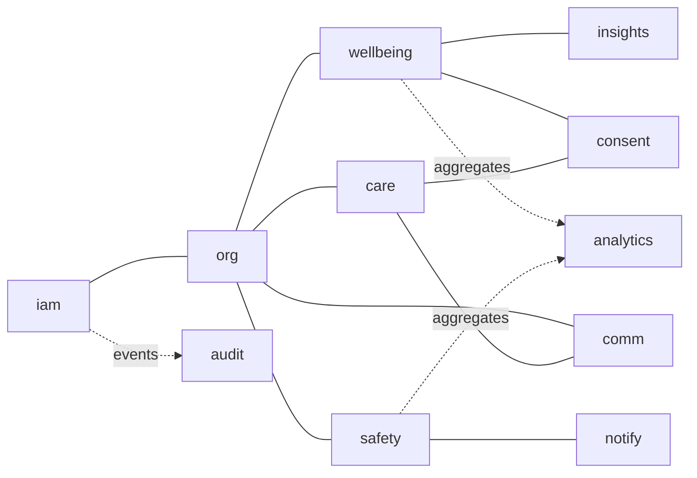
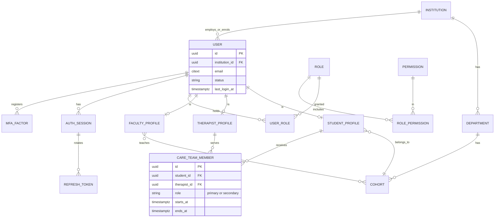
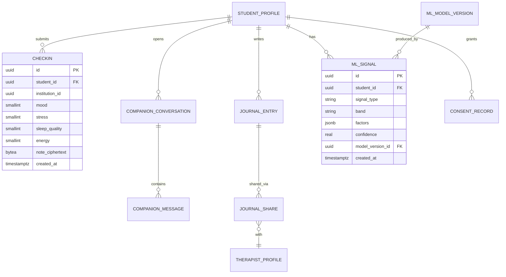
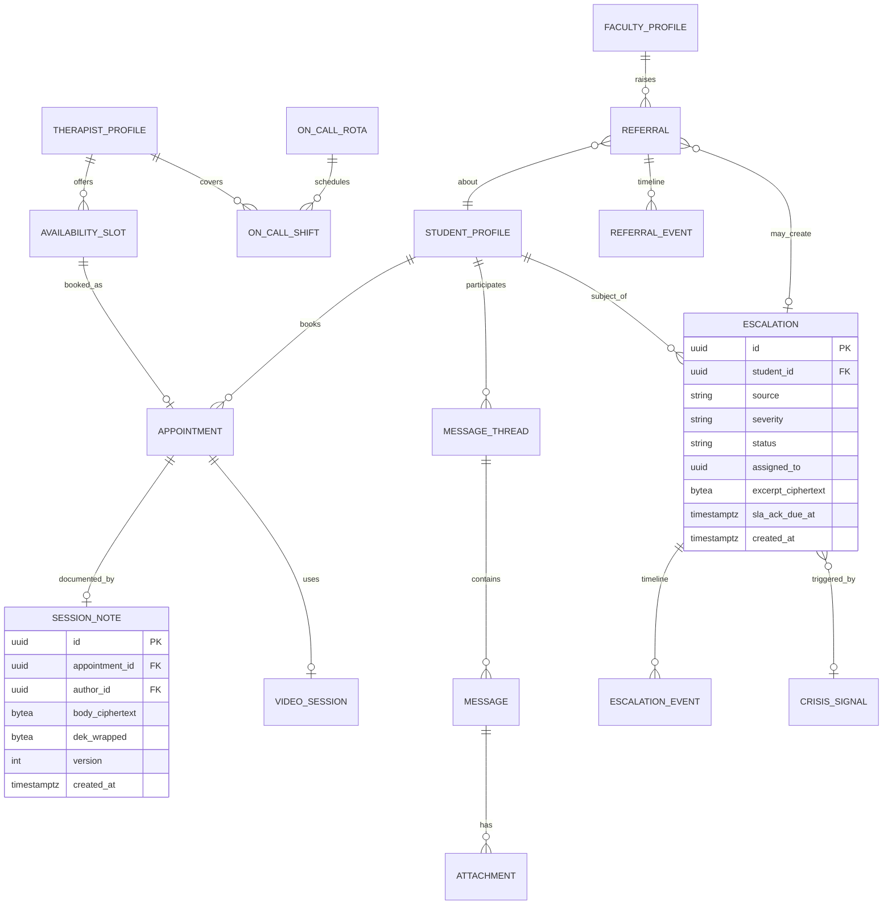
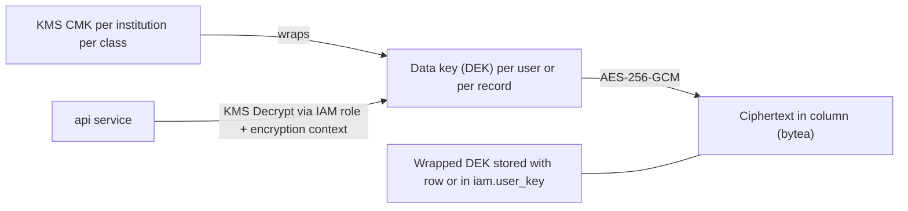

# MindMitra Database Design

- Status: **Proposed** (design only, no migrations yet)
- Engine: PostgreSQL 16 (AWS RDS Multi-AZ) with `pgcrypto`, `pg_trgm`, `pgvector`
- Related: [ARCHITECTURE.md §4](ARCHITECTURE.md#4-database-architecture), [SECURITY_ARCHITECTURE.md](SECURITY_ARCHITECTURE.md)

## 1. Design principles

1. **Tenant isolation**: every tenant-owned row carries `institution_id`; row-level security
   (RLS) enforces it even if application code has a bug.
2. **Classification-driven storage**: each column is classed Public / Internal / Personal /
   Sensitive / Clinical-Confidential; free text in the last two is field-encrypted.
3. **Bounded contexts own schemas**: no cross-schema writes; reads across contexts go through
   application services.
4. **Append-only where it matters**: audit, consent history, escalation timeline.
5. **UUIDv7 keys**, `timestamptz` everywhere (UTC), `created_at` / `updated_at` on all tables.
6. **Soft delete first, crypto-shred to erase**: per-record or per-user data keys can be
   destroyed to make ciphertext unrecoverable.
7. **Migrations** with Alembic, reviewed, backwards-compatible (expand/contract).

## 2. Schema map



| Schema | Owner context | Class |
|--------|--------------|-------|
| `iam` | identity & access | Personal / secret |
| `org` | institution structure and profiles | Personal |
| `consent` | consent and policy versions | Personal |
| `wellbeing` | check-ins, journal, companion | Sensitive |
| `insights` | ML signals and model versions | Sensitive |
| `care` | appointments, session notes, care team | Clinical-Confidential |
| `comm` | threads, messages, video sessions | Sensitive |
| `safety` | crisis signals, escalations, on-call, resources | Sensitive / Clinical |
| `referral` | faculty referrals | Sensitive |
| `notify` | notifications, outbox, preferences | Internal |
| `audit` | audit events | Restricted |
| `analytics` | aggregate tables only | Internal |

## 3. Entity-relationship diagrams

### 3.1 Identity, organisation and assignments



### 3.2 Wellbeing, insights and consent



### 3.3 Care, communication and safety



## 4. Table catalogue

Notation: **PK** primary key, **FK** foreign key, 🔒 field-encrypted, ⚑ indexed for hot path.
All tables also have `created_at`, `updated_at`; tenant tables have `institution_id` (omitted
below for brevity).

### 4.1 `iam`

| Table | Key columns | Notes |
|-------|-------------|-------|
| `user` | id PK, email (citext, unique per institution), status (`invited`,`active`,`suspended`,`deactivated`), display_name, last_login_at | No password here |
| `credential` | user_id PK/FK, password_hash (Argon2id), password_changed_at, failed_attempts, locked_until | Separate table, separate DB grants |
| `mfa_factor` | id, user_id, type (`totp`,`webauthn`), secret_ciphertext 🔒, verified_at | |
| `auth_session` | id, user_id, device_label, ip_hash, user_agent_hash, created_at, last_seen_at, revoked_at | |
| `refresh_token` | id, session_id, family_id, token_hash, rotated_at, expires_at, reuse_detected | Opaque tokens stored hashed |
| `role` | id, key (`student`,`therapist`,`faculty`,`institution_admin`,`platform_admin`,`clinical_supervisor`) | |
| `permission` | id, key (`checkin:read`, ...) | |
| `role_permission` | role_id, permission_id | |
| `user_role` | user_id, role_id, scope_type, scope_id | e.g. faculty scoped to cohort |
| `invitation` | id, email, role_id, token_hash, expires_at, accepted_at, invited_by | |
| `password_reset` | id, user_id, token_hash, expires_at, used_at | |

### 4.2 `org`

| Table | Key columns | Notes |
|-------|-------------|-------|
| `institution` | id, name, region, domain_allowlist[], settings jsonb, status | Tenant root |
| `department` | id, institution_id, name | |
| `cohort` | id, department_id, name, academic_year | Unit for faculty aggregates |
| `student_profile` | user_id PK, cohort_id, enrolment_year, preferred_name, pronouns, locale | Minimal; no DOB/address |
| `therapist_profile` | user_id PK, licence_number 🔒, specialties[], languages[], bio, accepting_new | |
| `faculty_profile` | user_id PK, department_id, title | |
| `faculty_cohort` | faculty_id, cohort_id | Cohorts a teacher may see aggregates for |
| `care_team_member` | id, student_id, therapist_id, role, starts_at, ends_at | Relationship backbone for authorization |

### 4.3 `consent`

| Table | Key columns | Notes |
|-------|-------------|-------|
| `policy_version` | id, kind (`terms`,`privacy`,`ai_notice`), version, effective_at, content_ref | |
| `consent_record` | id, user_id, scope, status (`granted`,`revoked`), policy_version_id, granted_at, revoked_at, source | **Append-only**; current state via view `consent.current` |
| `data_request` | id, user_id, type (`export`,`erasure`), status, requested_at, completed_at | Data subject requests |

### 4.4 `wellbeing`

| Table | Key columns | Notes |
|-------|-------------|-------|
| `checkin` | id, student_id ⚑, mood 1-5, stress 1-5, sleep_quality 1-5, energy 1-5, note_ciphertext 🔒, created_at ⚑ | Index `(student_id, created_at desc)` |
| `journal_entry` | id, student_id, title_ciphertext 🔒, body_ciphertext 🔒, mood_tag, created_at, deleted_at | Private by default |
| `journal_share` | id, entry_id, therapist_id, shared_at, revoked_at | Explicit per-entry sharing |
| `companion_conversation` | id, student_id, started_at, expires_at, deleted_at | `expires_at` from retention setting |
| `companion_message` | id, conversation_id, role (`user`,`assistant`), body_ciphertext 🔒, safety_flags, model_version | |
| `resource` | id, institution_id nullable, title, body, tags[], language, embedding vector(768), reviewed_by, reviewed_at | Vetted library, searched via pgvector |
| `resource_interaction` | id, student_id, resource_id, kind, created_at | |

### 4.5 `insights`

| Table | Key columns | Notes |
|-------|-------------|-------|
| `ml_model_version` | id, name, version, task, card_url, promoted_at, promoted_by | |
| `ml_signal` | id, student_id, signal_type (`support_need`,`engagement`,`sentiment`), band, score, factors jsonb, confidence, model_version_id, source_window | **Never contains diagnosis labels**; `band` is `low`/`moderate`/`elevated` |

### 4.6 `care`

| Table | Key columns | Notes |
|-------|-------------|-------|
| `availability_slot` | id, therapist_id, starts_at, ends_at, mode (`video`,`in_person`), status | |
| `appointment` | id, student_id, therapist_id, slot_id, status (`booked`,`confirmed`,`completed`,`cancelled`,`no_show`), reason_ciphertext 🔒, created_at | |
| `session_note` | id, appointment_id, author_id, body_ciphertext 🔒, dek_wrapped, version, locked_at | **Clinical-Confidential**; versioned (new row per edit, previous retained) |
| `session_note_access` | note_id, user_id, granted_by, reason, expires_at | Supervisor/break-glass access, audited |
| `video_session` | id, appointment_id, provider_meeting_id, started_at, ended_at | No recordings by default |

### 4.7 `comm`

| Table | Key columns | Notes |
|-------|-------------|-------|
| `message_thread` | id, student_id, care_team_id, status, last_message_at | One per student-care team |
| `message` | id, thread_id, sender_id, body_ciphertext 🔒, client_msg_id (idempotency), crisis_checked_at, created_at | |
| `message_read` | message_id, user_id, read_at | |
| `attachment` | id, message_id, s3_key, size, mime, scan_status | Scanned before availability |

### 4.8 `safety`

| Table | Key columns | Notes |
|-------|-------------|-------|
| `crisis_signal` | id, student_id, source (`checkin`,`companion`,`message`,`journal`,`help_button`,`referral`,`therapist`), detector (`rules`,`classifier`,`human`), category, confidence, excerpt_ciphertext 🔒, created_at | Minimal excerpt only |
| `escalation` | id, student_id, signal_id, severity (`moderate`,`high`,`imminent`), status (`open`,`acknowledged`,`reescalated`,`in_progress`,`emergency_contacted`,`referred_external`,`resolved`), assigned_to, sla_ack_due_at, resolved_at, outcome | Index `(institution_id, status, sla_ack_due_at)` |
| `escalation_event` | id, escalation_id, actor_id, type, note_ciphertext 🔒, created_at | Append-only timeline |
| `on_call_rota` | id, institution_id, name, escalation_policy jsonb | Levels, SLAs |
| `on_call_shift` | id, rota_id, therapist_id, level, starts_at, ends_at | |
| `crisis_resource` | id, institution_id nullable, kind (`helpline`,`campus_emergency`,`text_line`), name, contact, hours, language, sort | Also exported to static `/help` page |
| `break_glass_grant` | id, escalation_id, user_id, scope, granted_at, expires_at, reason | Time-boxed extra visibility |

### 4.9 `referral`

| Table | Key columns | Notes |
|-------|-------------|-------|
| `referral` | id, student_id, raised_by, category (`academic_distress`,`behaviour_change`,`wellbeing_concern`,`safety_concern`), urgency, note_ciphertext 🔒, status (`received`,`triaged`,`in_progress`,`closed`), created_at | |
| `referral_event` | id, referral_id, actor_id, type, created_at | Faculty sees only status-level events |

### 4.10 `notify`

| Table | Key columns | Notes |
|-------|-------------|-------|
| `outbox_event` | id, aggregate_type, aggregate_id, type, payload jsonb (IDs only), created_at, published_at | Transactional outbox |
| `notification` | id, user_id, type, priority, payload (IDs only), read_at, created_at | In-app inbox |
| `notification_preference` | user_id, channel, enabled, quiet_hours | |
| `delivery_log` | id, notification_id, channel, status, provider_msg_id, attempts, last_error | |
| `push_subscription` | id, user_id, endpoint_hash, keys_ciphertext | |

### 4.11 `audit`

| Table | Key columns | Notes |
|-------|-------------|-------|
| `audit_event` | id, institution_id, actor_id, actor_role, action, resource_type, resource_id, subject_student_id, outcome, reason, request_id, ip_hash, occurred_at, prev_hash, hash | Append-only, hash-chained per institution |

### 4.12 `analytics`

| Table | Key columns | Notes |
|-------|-------------|-------|
| `cohort_weekly` | institution_id, cohort_id, week, n_students, avg_mood, avg_stress, avg_sleep, checkin_rate, suppressed | Row published only if `n_students >= 10`; no individual IDs |
| `service_usage_daily` | institution_id, day, appointments_booked, messages_sent, companion_sessions | Counts only |
| `escalation_stats_weekly` | institution_id, week, count, median_ack_seconds, p95_ack_seconds | Counts only |
| `product_event` | day, event, count | No user IDs |

## 5. Encryption design

### 5.1 Envelope encryption



- Algorithm: **AES-256-GCM**, 96-bit random nonce, AAD = `table | column | row_id | institution_id`
  (binds ciphertext to its row and tenant).
- Key hierarchy: KMS CMK (per environment, per institution, per class: `sensitive`,
  `clinical`) → per-user DEK (`iam.user_key`, wrapped) for Sensitive data; per-note DEK for
  session notes. Unwrapped DEKs are cached briefly in memory only.
- **Crypto-shredding**: deleting a user's wrapped DEK (after retention checks) makes their
  Sensitive ciphertext unrecoverable, including in backups.
- **Searchability**: encrypted columns are not searchable; where lookup is needed (for
  example by email) a keyed HMAC "blind index" column is used. No full-text search over
  clinical text in v1.
- KMS encryption context includes `institution_id` and class, so a service cannot decrypt
  across tenants.

### 5.2 Column classification (examples)

| Column | Class | Protection |
|--------|-------|-----------|
| `user.email` | Personal | RBAC, TLS, disk encryption |
| `checkin.mood` etc. | Sensitive (structured) | RBAC + consent; disk encryption |
| `checkin.note_ciphertext` | Sensitive (free text) | Field encryption |
| `journal_entry.*_ciphertext` | Sensitive | Field encryption, owner-only |
| `session_note.body_ciphertext` | Clinical-Confidential | Field encryption, per-note DEK, author-only, audited |
| `escalation.excerpt_ciphertext` | Clinical-Confidential | Field encryption, care-team only |

## 6. Row-level security

Application connects as role `app_user`; each transaction sets:

```sql
SELECT set_config('app.user_id', :uid, true);
SELECT set_config('app.institution_id', :iid, true);
SELECT set_config('app.role', :role, true);
```

Example policies (illustrative, not final):

```sql
ALTER TABLE wellbeing.checkin ENABLE ROW LEVEL SECURITY;
ALTER TABLE wellbeing.checkin FORCE ROW LEVEL SECURITY;

-- Tenant isolation for all roles
CREATE POLICY tenant_isolation ON wellbeing.checkin
  USING (institution_id = current_setting('app.institution_id')::uuid);

-- Student sees own rows
CREATE POLICY student_own ON wellbeing.checkin FOR SELECT
  USING (student_id = current_setting('app.user_id')::uuid);

-- Therapist sees rows of students in active care team WITH consent
CREATE POLICY therapist_care_team ON wellbeing.checkin FOR SELECT
  USING (
    current_setting('app.role') = 'therapist'
    AND EXISTS (
      SELECT 1 FROM org.care_team_member c
      WHERE c.student_id = checkin.student_id
        AND c.therapist_id = current_setting('app.user_id')::uuid
        AND now() BETWEEN c.starts_at AND coalesce(c.ends_at, 'infinity')
    )
    AND consent.has_active('share_checkins_with_care_team', checkin.student_id)
  );
```

- **No policy** exists for `faculty` or `institution_admin` on `wellbeing`, `care`, `comm`,
  `insights`: default deny.
- Separate DB roles: `app_user` (OLTP), `analytics_reader` (only `analytics` schema),
  `audit_writer` (INSERT only on `audit`), `migrator` (DDL, not used at runtime),
  `readonly_support` (no access to ciphertext columns).
- Policy tests run in CI against a real Postgres (each role × table × operation).

## 7. Indexing and performance

| Table | Index | Purpose |
|-------|-------|---------|
| `checkin` | `(student_id, created_at DESC)` | Trend queries |
| `message` | `(thread_id, created_at)`; unique `(thread_id, client_msg_id)` | Pagination, idempotency |
| `appointment` | `(therapist_id, starts_at)`, `(student_id, starts_at)` | Calendars |
| `escalation` | partial `(institution_id, sla_ack_due_at) WHERE status IN ('open','reescalated')` | SLA timer scans |
| `care_team_member` | `(therapist_id, student_id) WHERE ends_at IS NULL` | Authorization joins |
| `audit_event` | `(institution_id, occurred_at)`, `(subject_student_id, occurred_at)` | Admin search, student access history |
| `resource` | HNSW on `embedding` | RAG retrieval |

Partitioning: `audit_event`, `message`, `checkin`, `delivery_log` partitioned monthly by
`created_at` once volume warrants it. Connection pooling via RDS Proxy / PgBouncer
(transaction mode; RLS settings use `set_config(..., true)` so they are transaction-local).

## 8. Retention and deletion

| Data | Mechanism |
|------|-----------|
| Companion messages | `expires_at` from consent setting; nightly `retention_sweep` hard-deletes |
| Check-ins / journal | Soft delete on request, crypto-shred after 30-day undo window |
| Messages, session notes, escalations | Retained per clinical records policy; erased after expiry; legal hold flag blocks deletion |
| Audit events | 7 years; immutable; partitions archived to S3 Glacier (Object Lock) |
| Outbox events | Deleted 7 days after publish |
| Backups | 35-day PITR; crypto-shredded keys render deleted data unreadable in older backups |

## 9. Backup and recovery

- Automated daily snapshots + PITR (RPO ≤ 5 min), Multi-AZ failover, cross-region encrypted
  snapshot copy, quarterly restore drills documented in runbooks.
- Redis is treated as ephemeral (rebuildable); the durable queue state is the outbox table.

## 10. Synthetic data and migrations

- `data/synthetic` provides generators for institutions, users, check-ins, appointments,
  messages and crisis scenarios; seeds are deterministic (fixed random seeds).
- Alembic migrations: one logical change each, expand → migrate → contract, tested up and
  down on a database populated with synthetic data. RLS policies are part of migrations and
  covered by tests.
