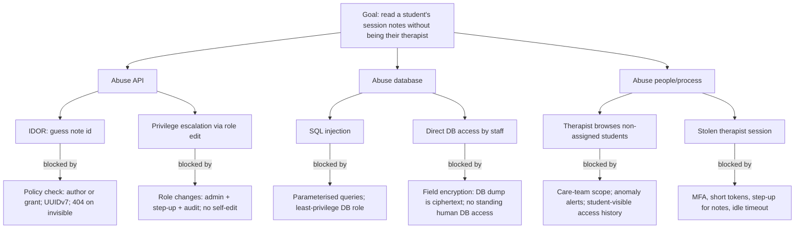
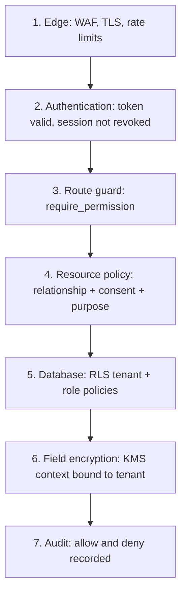

# MindMitra Security Architecture

- Status: **Partially implemented.** Authentication and authorization (sections 3-4) are built in
  `services/api`; section 0 states exactly what exists and where it differs from this design.
  Where they disagree, **section 0 is authoritative**.
- Baseline: OWASP ASVS Level 2 overall, Level 3 controls for Clinical-Confidential data
- Related: [ARCHITECTURE.md](ARCHITECTURE.md), [DATABASE_DESIGN.md §5-6](DATABASE_DESIGN.md#5-encryption-design), [API_DESIGN.md](API_DESIGN.md)

## 0. Implementation status (authentication and authorization, as built)

Code: `services/api/app/domain/auth/` (roles, permissions, resource policies, password policy),
`app/application/auth/` (auth use cases), `app/application/{care,insights,admin,access}.py`
(protected use cases), `app/api/` (routes, guards, error mapping), `app/core/access_tokens.py`
(JWT signing), migration `0003_auth_sessions`. Verified against PostgreSQL 16 with 246 tests,
`ruff`, `mypy --strict` and `pip-audit`. Thirteen deliberate authorization bugs (dropping a
tenant filter, the consent check, the CSRF check, the role re-check and so on) were each
injected in turn, and the suite failed for every one.

### 0.1 What exists

| Area | Implementation |
|------|----------------|
| Password hashing | Argon2id (argon2-cffi defaults, RFC 9106 low-memory profile); hashes upgraded on login when parameters change; plaintext never stored, logged or echoed in errors |
| Password policy | 12-128 characters, no composition rules, small deny-list of common passwords, at least 4 distinct characters, must not contain the e-mail's local part |
| Access token | EdDSA (Ed25519) JWT, 10 min, claims `iss`, `aud`, `sub`, `inst`, `role`, `sid`, `typ=access`, `jti`, `iat`, `nbf`, `exp`, header `kid`. Only `EdDSA` is accepted (no `none`, no HMAC confusion). Key from `JWT_PRIVATE_KEY` |
| Refresh token | Opaque 256-bit, stored as SHA-256 in `iam.refresh_tokens`, single use, rotated on every refresh; replay of a rotated token revokes the whole session (`refresh_reuse`). Expires after 7 days unused and never after the session's absolute lifetime |
| Sessions | `iam.auth_sessions`: absolute lifetime 30 days for students, 12 h for staff; revoked on logout, password reset, suspension/deactivation, or refresh reuse. Client IP stored only as a keyed hash |
| Per-request check | Every authenticated request re-reads the session and user: session live, user `active` and not deleted, user's current role equal to the token's role. Logout, password change, suspension and role changes therefore apply on the next request ([ADR 0003](adr/0003-access-token-transport-and-session-checks.md)) |
| CSRF | Only `/auth/refresh` uses a cookie; it requires `X-CSRF-Token`, bound server-side to that refresh token, checked before reuse detection |
| Lockout | After 5 failures (configurable) the account locks for 1, 2, 4, 8 minutes, capped at 15; never permanent. The correct password is refused during the lock with the same answer |
| Enumeration resistance | Login answers `401 Invalid email or password.` for unknown e-mail, wrong password, locked and non-active accounts alike, and unknown e-mails still pay for one Argon2 verification. Register and forgot-password always answer `202` |
| One-time tokens | `iam.one_time_tokens` (hashed, single use, purpose-bound): e-mail verification 24 h, password reset 30 min, account setup 72 h. A new link supersedes older unused ones. A rejected new password does not burn the token |
| Registration | Students only, with an e-mail on one of the institution's `email_domains` (or a subdomain); account starts `invited`, becomes `active` after verifying the e-mail; records the terms consent. The role can never be chosen by the caller |
| Admin-created accounts | Institution admins create `invited` users of any role in their own institution; the person sets their own password via an account-setup link (admins never handle passwords) |
| Token delivery | `TokenDelivery` interface; an in-memory outbox is used in development and tests. The app refuses to start in staging/production until a real e-mail sender is configured |
| Rate limiting | 20 requests per minute per client IP across the public auth endpoints, `429` with `Retry-After` (in-process sliding window) |
| Errors and headers | RFC 9457 problem responses with `request_id`; validation errors never echo input; `X-Request-ID`, `nosniff`, `X-Frame-Options: DENY`, `Referrer-Policy: no-referrer`, `Cache-Control: no-store`, CSP `default-src 'none'`, HSTS; CORS only for configured origins |
| Audit | Login success/failure (with reason), logout, registration, verification, reset, user and config changes, every denied authorization (in its own transaction, so it survives the request's rollback) and every therapist read of wellness data or therapy notes. Metadata only |

### 0.2 Roles, permissions and policies

Layers 2-4 and 7 of §4.1 are built: `get_principal` (token plus database session check), a route
guard on every non-public route (`require_permission`, or `authenticated()` for logout), resource
policies in `app/domain/auth/policies.py`, and audit of allow and deny. A test fails the build if
any route has no guard and is not in `PUBLIC_ROUTES`.

| Role (`user_role`) | Permissions |
|--------------------|-------------|
| `student` | own profile, own wellness records, own appointments, own AI conversations |
| `therapist` | own profile and availability, assigned students (verified therapists only), assigned students' wellness (with consent), own therapy notes, manage own appointments and sessions, alerts, follow-ups and recommendations for assigned students |
| `teacher` | own profile, aggregated insights for their own classes and department (consenting students only, small groups suppressed), referrals and student support requests for students they teach, faculty-tagged resources. Never: check-ins of an individual, journals, AI conversations, messages, therapy notes, diagnoses |
| `administrator` | own profile, aggregated insights, manage accounts, therapist verification, student/teacher/therapist records, departments, courses, resources, appointment counts, platform analytics, notification and safety settings, institution configuration, read audit metadata. **No** content permission ([ADR 0008](adr/0008-administrator-portal-scope-and-confidentiality.md)) |

| Resource policy | Rule |
|-----------------|------|
| Student wellness | The student; or a therapist with an active care-team link **and** an active `share_mood_with_care_team` consent (the private note is never returned to the therapist). Nobody else |
| Therapy notes | Only the therapist who wrote the note, while verified and on the student's care team. Not the student, teachers, admins, other therapists (including colleagues on the same care team) or other institutions. Versioned; responses are `no-store`; the audit log records the action and version, never content ([ADR 0006](adr/0006-therapist-portal-access-verification-and-note-confidentiality.md)) |
| Therapist verification | Only an administrator of the same institution, never for themself. Unverified, rejected and expired therapists get `403` on every student-data route and are hidden from the student directory |
| AI conversations | Only the owning student (INV-8). Not therapists, teachers or admins |
| Appointments | The appointment's therapist may confirm, cancel, complete or mark no-show (valid transitions only); students read their own |
| Users and configuration | Admins of the same institution; an admin cannot change their own status. Admin records carry administrative fields only (no consent, care-team, wellbeing or appointment participants) |
| Resources and crisis contacts | Admins edit their institution's own; items shipped with the product are read only; the last active emergency contact cannot be removed ([ADR 0008](adr/0008-administrator-portal-scope-and-confidentiality.md)) |
| Insights | Teachers: own classes and own department only. Admins: any department of their institution. Only students with an active `anonymous_aggregate_research` consent count. Groups under 10 students are suppressed (INV-4); shares need 5 students on each side; windows are fixed ([ADR 0007](adr/0007-teacher-portal-aggregation-thresholds-and-referrals.md)) |
| Teacher referrals | A teacher can refer only a student enrolled in a class they teach; sees back only category, urgency, their own note and status. Verified therapists triage; `safety_concern` raises an alert for humans |
| Tenancy | A record from another institution is indistinguishable from a missing one (`404`) |

Invariant coverage: INV-1, INV-2 (no admin route reaches content; the audit view is metadata),
INV-3 (without break-glass), INV-4, INV-5 (application layer), INV-7 (therapy notes and wellness
reads) and INV-8 are enforced and tested in `tests/test_rbac_api.py` and
`tests/test_authz_rules.py`.

### 0.3 Differences from this design

| Area | Design said | Implemented | Reason / next step |
|------|-------------|-------------|--------------------|
| Access token transport | `__Host-access` httpOnly cookie + double-submit CSRF | Returned in the body, sent as `Authorization: Bearer`, kept in memory | [ADR 0003](adr/0003-access-token-transport-and-session-checks.md) |
| Refresh cookie name | `__Host-refresh` | `__Secure-mm_refresh`, `Path=/api/v1/auth` | `__Host-` requires `Path=/`; the narrow path keeps the token off every other request |
| Revocation | Redis denylist keyed by `sid` | Database session check on every request | Redis not wired yet; ADR 0003 |
| Locked account | `423` | Same `401` as any failed login | Avoids revealing that the account exists |
| JWT `roles`, `amr` claims | List of roles, auth method | Single `role` (one role per user in the data model); `amr` added with MFA | Data model has one role per user |
| Idle timeout | 15 min (staff clinical area) / 60 min (students) | Not yet; absolute lifetime and 7-day refresh idle only | Needs the frontend session bootstrap |
| Permission names | `checkin:read` style | `wellness:read:own`, `therapy_note:read`, ... (see `permissions.py`) | Named after the implemented entities |
| Rate limiting | Redis, per account and IP | In-process, per IP, auth endpoints only | Moves to Redis with the worker phase; interface unchanged |
| Pepper, breached-password check, reuse of last 5 | Required | Not yet | Need Secrets Manager and an offline breach corpus |
| MFA, step-up, WebAuthn, SSO, break-glass, device list | Designed | Not built | Later phases |
| Row-level security (layer 5) | PostgreSQL RLS policies | Not yet; tenant scoping is enforced in every query and by composite foreign keys | Planned next for defence in depth |

## 1. Security objectives

1. **Confidentiality**: therapy and wellbeing data is visible only to people with a need, a
   relationship and (where required) consent.
2. **Integrity**: clinical records and audit logs are tamper-evident.
3. **Availability of the crisis path**: students can always reach help.
4. **Accountability**: every sensitive access is attributable.
5. **Privacy by design**: minimise, separate, encrypt, expire.

## 2. Threat model

### 2.1 Assets (ranked)

| Rank | Asset | Class |
|-----:|-------|-------|
| 1 | Session notes, escalation details | Clinical-Confidential |
| 2 | Journals, companion chats, messages, check-in notes, ML signals | Sensitive |
| 3 | Identity data, credentials, tokens, keys | Personal / secret |
| 4 | Aggregates, configuration | Internal |
| 5 | Audit logs | Restricted (integrity-critical) |

### 2.2 Actors

| Actor | Motivation / capability |
|-------|-------------------------|
| External attacker | Data theft, extortion; web exploits, credential stuffing, phishing |
| Curious insider (teacher/admin/therapist) | Looks up a student they know; legitimate credentials |
| Malicious student | Tries to reach others' data, abuse companion (prompt injection) |
| Compromised third party | LLM, SMS/email vendor, npm/pip dependency |
| Peer/ex-partner of student | Account takeover, shared device snooping |
| Cloud misconfiguration | Public bucket, over-broad IAM |

### 2.3 STRIDE summary

| Threat | Example | Primary controls |
|--------|---------|------------------|
| **S**poofing | Credential stuffing, stolen session | Argon2id, MFA, rate limits, breached-password check, token rotation with reuse detection, device/session list |
| **T**ampering | Altering a session note or audit row | Versioned notes, hash-chained audit, DB grants (no UPDATE/DELETE on audit), integrity monitoring |
| **R**epudiation | Therapist denies viewing a record | Append-only audit with actor, reason, request id |
| **I**nformation disclosure | IDOR, teacher reads notes, log leakage, over-broad API response | Central policy layer, RLS, field encryption, 404-on-invisible, log scrubbing, response schemas allow-list |
| **D**enial of service | Flood login, flood companion (cost) | WAF, rate limits, per-user AI quotas, autoscaling, static crisis page |
| **E**levation of privilege | Student calls therapist endpoint, role tampering | Server-side role lookup, JWT minimal claims, permission tests per route, admin changes need step-up |

### 2.4 Attack trees (top concerns)

## 3. Authentication

### 3.1 Credentials and policy

| Control | Setting |
|---------|---------|
| Password hashing | Argon2id (m=64 MiB, t=3, p=1 initially; tuned to ~250 ms), per-user salt, server-side pepper from Secrets Manager |
| Password rules | ≥ 12 chars, no composition rules, breached-password check, no reuse of last 5 |
| Lockout | Progressive delay and temporary lock after 5 failures per account + IP-aware throttling; no hard lock that enables denial of service for a student in distress |
| MFA | TOTP mandatory for therapist, admin, platform admin; offered to students/faculty; WebAuthn passkeys in a later phase; recovery codes hashed |
| Account recovery | Email link (single-use, 30 min, hashed); MFA reset requires admin + identity check |
| Enumeration resistance | Identical responses/timing for unknown email on login, reset and register |
| SSO | OIDC then SAML per institution (Phase 9); local MFA policy still enforced for therapists |

### 3.2 Tokens and sessions

| Token | Format | Lifetime | Storage |
|-------|--------|----------|---------|
| Access | JWT (EdDSA), claims: `sub`, `inst`, `roles`, `sid`, `iat`, `exp`, `amr` | 10 min | `__Host-access` httpOnly Secure SameSite=Lax cookie |
| Refresh | Opaque 256-bit random | 7 days idle / 30 days absolute | `__Host-refresh` cookie; stored **hashed** (SHA-256) server-side |
| CSRF | Double-submit random token bound to session | Session | Non-httpOnly cookie + `X-CSRF-Token` header |
| MFA token | Short JWT, `scope=mfa` | 5 min | Memory only |
| WS ticket | One-time random | 30 s | Redis |
| Service token (api→ml) | JWT `aud=ml` | 5 min | In memory, signed with key from Secrets Manager |

- **Refresh rotation with family reuse detection**: reuse of an already-rotated token revokes
  the entire family and forces re-login (alerts security).
- Access JWTs carry roles but **permissions are re-evaluated server-side each request**;
  deactivation takes effect within the next request via session revocation check (Redis
  denylist keyed by `sid`).
- Idle timeouts: 15 min for therapists/admins in the clinical area (with warning), 60 min for
  students (configurable), absolute 12 h for staff.
- **Step-up authentication** (fresh password + MFA within 5 min) is required for: exporting
  data, changing roles, viewing session notes in bulk, break-glass, disabling MFA.

### 3.3 Login sequence

See the sequence diagram in [ARCHITECTURE.md §7](ARCHITECTURE.md#7-authentication-architecture).

## 4. Authorization (RBAC + ABAC)

### 4.1 Layers

Any single layer failing open should still leave the others denying access.

### 4.2 Policy engine

- Policies are **pure Python functions** in `domain/policies` taking `(actor, action,
  resource, context)` and returning `Allow(reason)` or `Deny(reason)`.
- Context includes: care-team relationships, active consents, active break-glass grants, and
  institution settings.
- Policy results are logged (deny always, allow for Sensitive/Clinical).
- The policy module has no framework imports and is tested exhaustively, including
  property-based tests for "teacher never allowed on clinical resource types".

### 4.3 Hard invariants (tested in CI)

| ID | Invariant |
|----|-----------|
| INV-1 | Faculty can never read `care.*`, `comm.*`, `wellbeing.*`, `insights.*`, `safety.escalation*` content |
| INV-2 | Institution admins can read metadata only (counts, statuses, timestamps), never ciphertext fields |
| INV-3 | A therapist can read student data only with an active care-team row and (for check-ins/signals) active consent, or an active audited break-glass grant |
| INV-4 | Aggregate endpoints never return a cell with fewer than 10 individuals |
| INV-5 | Cross-tenant access is impossible even with a valid token (RLS + policy) |
| INV-6 | The ML service never receives user identifiers or persists text |
| INV-7 | Every read of Clinical-Confidential data writes an audit event |
| INV-8 | Companion content is never visible to anyone except the owning student |

### 4.4 Break-glass

A clinical supervisor can open a time-boxed (≤ 24 h), reason-required grant for a specific
escalation. It: requires step-up auth, is visible to the student afterwards ("your
information was accessed in an emergency"), triggers an alert to the clinical lead and
privacy officer, and auto-expires.

## 5. Encryption and key management

| Layer | Mechanism |
|-------|-----------|
| In transit | TLS 1.2+ (prefer 1.3) at CloudFront and ALB; TLS inside VPC for RDS, Redis, ML service (mTLS between services on ECS Service Connect is a stretch goal) |
| At rest (infra) | RDS, EBS, S3, ElastiCache encrypted with KMS CMKs |
| At rest (application) | AES-256-GCM envelope encryption for free text and clinical fields, AAD binds to row and tenant ([DATABASE_DESIGN.md §5](DATABASE_DESIGN.md#5-encryption-design)) |
| Keys | KMS CMKs per environment, institution and class; annual automatic rotation; deletion protection with 30-day waiting period; separate IAM roles for encrypt vs decrypt |
| Secrets | Secrets Manager (pepper, JWT signing keys, DB creds) with rotation; no secrets in images, env files or Git |
| Backups | Encrypted with the same CMK family; restore tested |
| Client side | No sensitive data in localStorage / sessionStorage / URLs; `Cache-Control: no-store` on authenticated responses |

## 6. Application security controls

### 6.1 Web (Next.js)

- Strict **CSP** (nonce-based, no inline scripts, `frame-ancestors 'none'`), HSTS preload,
  `X-Content-Type-Options`, `Referrer-Policy: same-origin`, `Permissions-Policy` (camera and
  mic only on the video page).
- React escapes output; no `dangerouslySetInnerHTML` except via a sanitised markdown renderer
  (allow-listed, DOMPurify) for vetted resources.
- Subresource integrity for any third-party script (target: none on authenticated pages).
- No third-party analytics or session-replay on authenticated pages.

### 6.2 API (FastAPI)

- Pydantic strict validation, request size limits, content-type allow-list.
- SQL via SQLAlchemy parameters only; ORM raw SQL banned by lint rule.
- SSRF protection: no user-supplied URLs fetched server-side.
- File uploads: pre-signed S3 URLs, size/type limits, antivirus scan (ClamAV Lambda) before
  release, served via short-lived URLs with `Content-Disposition: attachment`.
- Mass-assignment protection: separate input and output schemas.
- Uniform 404 for invisible resources; constant-time comparisons for tokens.
- CORS allow-list; CSRF protection on cookie-authenticated unsafe methods.

### 6.3 AI-specific (see [AI_ML_ARCHITECTURE.md](AI_ML_ARCHITECTURE.md))

- Companion has no tools, DB, or network access; context = own session + vetted resources.
- Prompt-injection and jailbreak test suite in CI; output PII scrub; per-user quotas.
- Provider contract: no training on data, no retention beyond processing, region-pinned.

### 6.4 Supply chain

- Lockfiles, pinned versions, Dependabot/Renovate, `pip-audit`, `npm audit`, Trivy image
  scan, SBOM (CycloneDX) per build, signed images (cosign), GitHub Actions pinned by SHA.
- Minimal base images (distroless / slim), non-root containers, read-only root FS.
- Dependencies are added only when needed (CLAUDE.md), with justification.

## 7. Audit and monitoring

### 7.1 Audit log

| Aspect | Design |
|--------|--------|
| What | All authentication events, role/assignment changes, every read/write of Sensitive and Clinical data, consent changes, exports, break-glass, admin config changes, authorization denials |
| Content | `actor`, `role`, `action`, `resource_type/id`, `subject_student_id`, `outcome`, `reason`, `request_id`, `ip_hash`, time. **Never** content bodies |
| Integrity | Append-only table; DB role has INSERT only; each row stores `hash = H(prev_hash || row)`; hourly chain checkpoint written to S3 Object Lock (WORM) |
| Access | Admins search metadata; students see a role-level view of access to their own data; export to SIEM |
| Retention | 7 years |

### 7.2 Detection and response

| Signal | Alert |
|--------|-------|
| Therapist reads unusually many non-recent students, or students outside care team | Privacy officer review |
| Many 403s from one actor (probing) | Security on-call |
| Refresh-token reuse | Security on-call, session family revoked |
| Unacknowledged critical escalation | Clinical + platform on-call |
| Crisis detector errors/timeouts spike | Platform on-call |
| KMS decrypt anomalies, IAM changes, GuardDuty findings | Security on-call |
| Failed audit hash chain verification | Critical incident |

Tools: CloudWatch Logs/Alarms, GuardDuty, Security Hub, AWS Config, CloudTrail (org-wide),
Sentry (PII scrubbed), OpenTelemetry. Logs contain IDs, never message bodies or PII.

### 7.3 Incident response

Runbooks for: credential compromise, suspected data exposure, crisis-path outage, model
misbehaviour (kill switch), key compromise. Breach notification workflow aligned with
DPDP/GDPR timelines (e.g. 72 h to regulator where applicable). Quarterly tabletop exercises
including a "missed escalation" scenario.

## 8. Infrastructure security (AWS)

| Area | Controls |
|------|----------|
| Accounts | Separate AWS accounts per environment (dev, staging, prod) and a security/logging account; SCPs deny risky actions; root MFA and no root keys |
| Network | 3-AZ VPC; private subnets for app and data; data subnets have no internet route; security groups least-privilege (api→rds, api→redis, api→ml only); VPC endpoints for AWS services; WAF on CloudFront/ALB; Shield Standard |
| Identity | IAM roles per ECS task (no long-lived keys); GitHub Actions uses OIDC; human access via IAM Identity Center with MFA; no standing DB access (time-boxed break-glass via SSM) |
| Data | S3 Block Public Access org-wide; bucket policies require TLS and KMS; RDS not publicly accessible; deletion protection on RDS and CMKs |
| Hardening | Fargate (no host management), container image scanning, ECR immutable tags, SSM Parameter/Secrets rotation |
| Logging | CloudTrail, VPC Flow Logs, ALB/WAF logs to a central immutable bucket |
| IaC | Terraform with tfsec/Checkov in CI; plans reviewed; drift detection |

## 9. Secure SDLC

1. Threat-model review for each new feature touching Sensitive or Clinical data.
2. PR checklist: authorization, audit, tests, no secrets, no PII in logs.
3. CI gates: lint, type-check, unit/integration tests, authorization matrix, RLS tests, SAST
   (Bandit, Semgrep, ESLint security), secret scanning (gitleaks), dependency and container
   scans, IaC scanning, license check.
4. DAST (OWASP ZAP) against staging per release; external penetration test before launch and
   annually.
5. Synthetic data only outside production; production access is restricted and logged.
6. Security champions rotation; yearly privacy and security training for staff.

## 10. Privacy engineering controls

- **Data minimisation**: no DOB, address, government IDs; profile minimal.
- **Purpose limitation**: analytics DB role cannot read OLTP; ML training uses only consented
  de-identified data.
- **Pseudonymisation**: ML features reference opaque ids; ML never receives names/emails.
- **Transparency**: plain-language privacy centre, AI notice, access history.
- **DPIA** completed before launch; Records of Processing maintained; DPO / privacy officer
  role named per institution.
- **Vendor management**: DPAs with LLM (Bedrock/AWS), email/SMS providers; sub-processor list.

## 11. Compliance mapping (design intent, not legal advice)

| Regime | Relevant design elements |
|--------|-------------------------|
| India DPDP Act 2023 | Consent records, purpose limitation, erasure, breach notification, children's data (18+ platform; minors need guardian flow if enrolled), Data Protection Officer |
| GDPR (if EU students) | Lawful basis, special-category data safeguards, DSAR tooling, DPIA, data residency, SCCs |
| FERPA (US) | Institution-controlled education records; access logging; directory-info exclusion |
| HIPAA-style safeguards | Access control, audit, encryption, minimum necessary, BAAs if US covered entities |
| Local mental-health records rules | Retention, access by patient, confidentiality exceptions (duty to warn) configured by institution |

Legal and clinical review is required before production use.

## 12. Residual risks (see also [ARCHITECTURE.md §17](ARCHITECTURE.md#17-architectural-risks-and-mitigations))

- Figures cover completed weeks only, and each closed window is stored at its first read, so late edits cannot move it. Consent or status changes still drop the stored window, which a teacher can observe but not cause ([ADR 0007](adr/0007-teacher-portal-aggregation-thresholds-and-referrals.md)).
- Overlapping groups (a class and its department, or two classes sharing students) can in principle be compared to infer something about the difference. Fixed windows, rounding, size bands and the 10/5 thresholds make this impractical for small differences but do not remove it ([ADR 0007](adr/0007-teacher-portal-aggregation-thresholds-and-referrals.md)).
- A compromised administrator account can suspend people, change structure and settings, and read audit metadata, but not content. Weekly activity counts of 1 to 4 are hidden, while safety-alert counts on the dashboard are exact, so "one alert is waiting" is visible to administrators ([ADR 0008](adr/0008-administrator-portal-scope-and-confidentiality.md)).
- Reminder, goal-reminder and email settings are stored but nothing sends them yet (no scheduler or email delivery); the interface says so.
- Insider misuse with legitimate access can be deterred and detected but not fully prevented.
- Shared or monitored personal devices can expose students; mitigations: quick-exit button,
  content-free notifications, session timeouts, discreet app naming option.
- Free-text crisis detection will never be perfect; the system is designed so humans and
  explicit help paths are always available.
