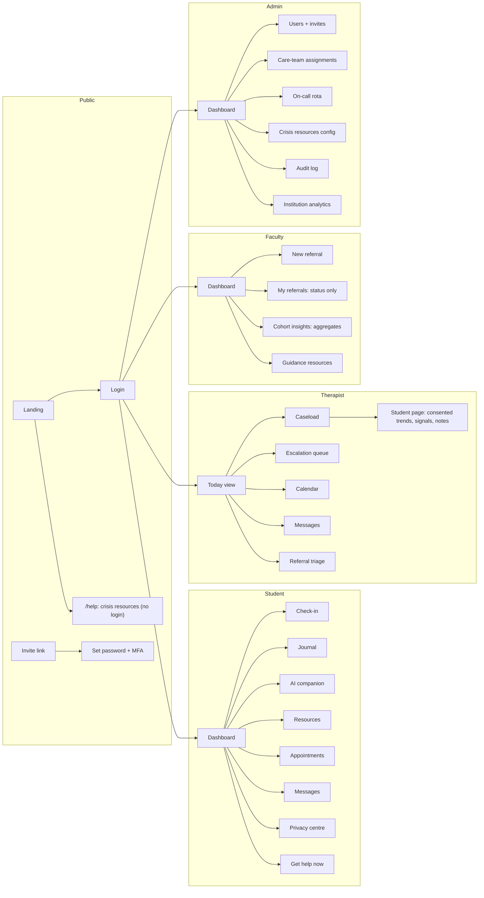
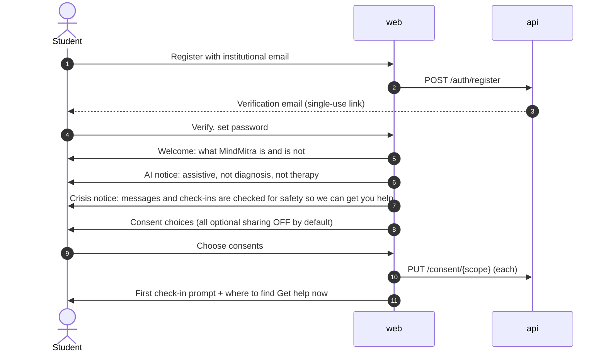
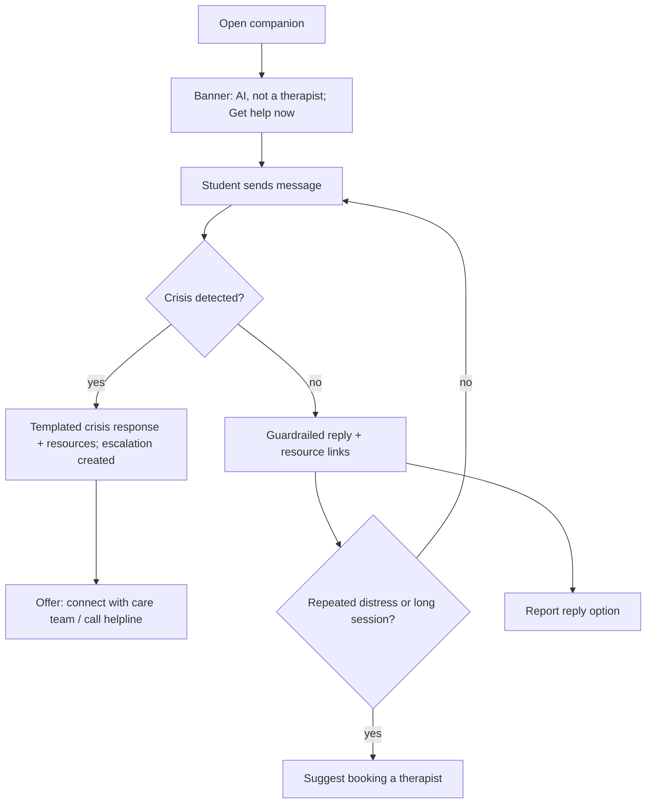
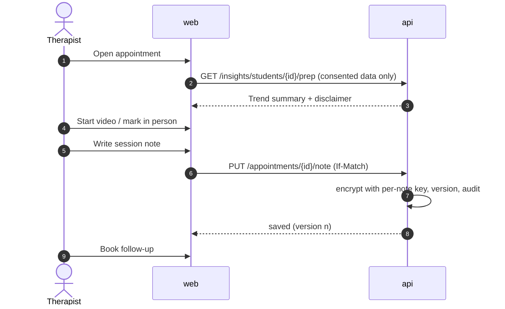
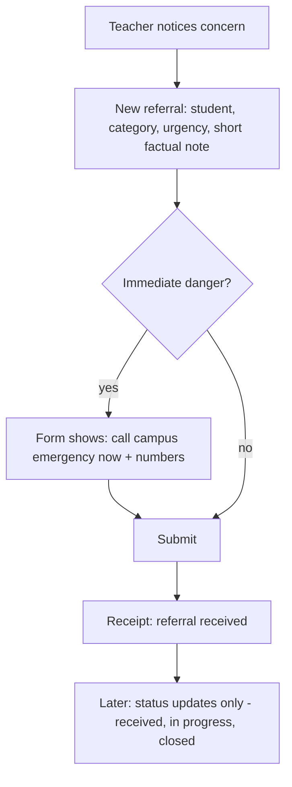
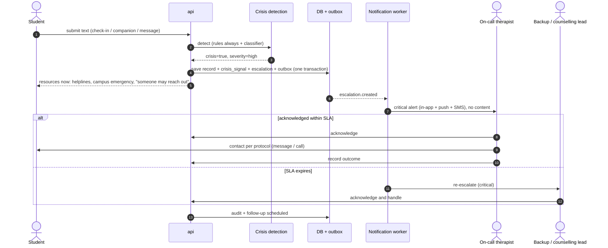
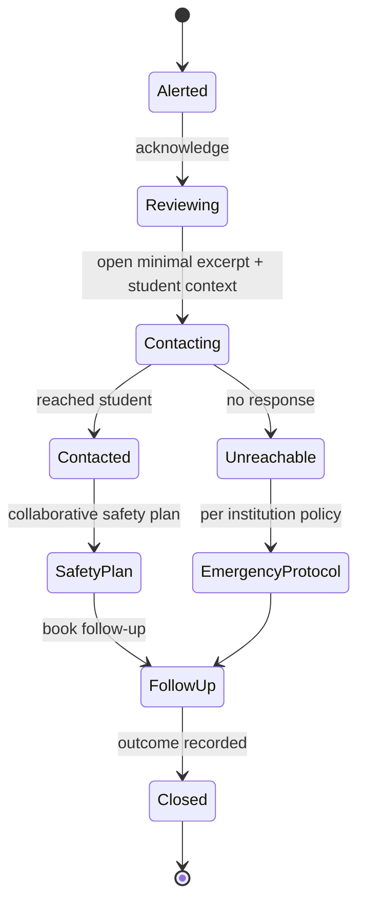

# MindMitra User Flows

- Status: **Proposed** (design only)
- Related: [ARCHITECTURE.md](ARCHITECTURE.md), [API_DESIGN.md](API_DESIGN.md)

Conventions: each flow lists the actor, preconditions, steps, privacy notes and failure
handling. Crisis flows always take priority over everything else.

## 1. Navigation map by role

## 2. Onboarding

### 2.1 Student onboarding

Privacy notes: optional sharing defaults to off; consent texts are versioned; skipping
optional consents never blocks use.

### 2.2 Staff onboarding (therapist / faculty / admin)

1. Institution admin sends invite (`POST /users/invitations`) with role and scope (cohorts for
   faculty).
2. Invitee opens link, sets password, **enrols TOTP** (mandatory for therapists/admins).
3. Role-specific orientation: confidentiality rules (faculty: "you will see status only"),
   escalation duties (therapists), "admins cannot see clinical content".

## 3. Student flows

### 3.1 Daily check-in

1. Student opens Check-in (≤ 30 s flow): mood, stress, sleep, energy sliders, optional note.
2. Submit → API stores; note runs synchronous crisis detection.
3. **Normal**: gentle acknowledgement + 1–2 suggested resources; trend chart updated.
4. **Crisis indicators**: see [§7.1](#71-crisis-detected-in-student-text).
5. Async: support-need signal computed; if it rises and consent allows, care team is notified
   ("a student on your caseload may benefit from a check-in").

Failure handling: if ML is down, rules still run; the check-in is saved; insight shows later.

### 3.2 Private journal

1. Write entry → encrypted at rest; private by default.
2. Optional: "Share this entry with my therapist" → per-entry share, revocable.
3. Crisis scanning on journal only if student opted in (`journal_safety_scanning`).

### 3.3 AI wellness companion

Privacy notes: conversations visible only to the student; retention per student choice
(0/30/90 days); delete anytime.

### 3.4 Book an appointment

1. Student browses therapists (or sees assigned therapist first) → open slots.
2. Selects slot → `POST /appointments` (idempotent) → confirmation + calendar file.
3. Reminders 24 h and 1 h before (content-free text).
4. At time: join video (short-lived token) or attend in person.
5. Reschedule/cancel within policy window; no-show handling by therapist.

Failure handling: slot conflict returns 409 with alternative slots.

### 3.5 Secure messaging

1. Student opens thread with care team; sees expected response time and "this is not for
   emergencies" note with Get help now.
2. Sends message → crisis check → stored encrypted → therapist notified in-app.
3. Off-hours: auto-reply with crisis resources and next availability.

### 3.6 Privacy centre

- View and change consents (effective immediately).
- "Who accessed my data" (e.g. "Your therapist viewed your check-ins on 8 Oct").
- Export my data (async, 24 h encrypted link).
- Delete my data (explains what is retained by law, e.g. clinical records).
- Quick-exit button and discreet notification settings.

## 4. Therapist flows

### 4.1 Today view and caseload

1. Login with MFA → Today: escalations needing action (top, with SLA timers), today's
   appointments, unread messages, students flagged by support-need signals (consented).
2. Open a student page: profile basics, consented check-in trends, signals **with disclaimers
   and factors**, shared journal entries, appointment history, own session notes.
3. Every open of a student page is audited.

### 4.2 Session and notes

Notes are visible only to the author (and supervisors with an audited grant). Edits create
versions; notes lock after a configurable period.

### 4.3 Referral triage

1. Referral arrives in triage queue (category, urgency, teacher's note).
2. Therapist triages: assign to self/colleague, contact student, or close with reason.
3. Status changes propagate to the teacher as status only.
4. "Safety concern" referrals arrive as escalations (see §7.3).

### 4.4 Handoff

When a therapist leaves or rotates: admin reassigns care team; outgoing therapist writes a
handoff note (clinical, author + incoming therapist); student is notified of the change.

## 5. Faculty flows

### 5.1 Raise a concern

Guidance on the form: describe observable behaviour, avoid labels or diagnoses, do not
investigate. Teachers never learn whether the student is in therapy or any outcome detail.

### 5.2 Cohort insights

1. Teacher selects one of their cohorts and a time range (weekly granularity).
2. Sees aggregate mood/stress/sleep trends, check-in participation, and suggested supportive
   actions (e.g. "stress rises in exam weeks; consider deadline spacing").
3. Cohorts or cells with fewer than 10 students are suppressed with an explanation.
4. No filters that could isolate individuals (no gender × small cohort cross-tabs).

## 6. Administrator flows

### 6.1 Institution setup

1. Platform admin provisions institution (region, domain allow-list).
2. Institution admin configures: departments, cohorts, crisis resources (helplines, campus
   emergency), on-call rota and escalation SLAs, retention settings, AI feature toggles.
3. **Go-live checklist enforced**: at least one active on-call rota covering 24/7 (or explicit
   off-hours protocol with helplines), crisis resources configured, therapists onboarded with
   MFA.

### 6.2 User management

- Invite, bulk-invite students (CSV of emails only), deactivate, change role (step-up, audited),
  assign therapists to students.
- Admin UI never shows clinical fields; student detail shows account metadata only.

### 6.3 Audit and oversight

- Search audit events by actor, student (pseudonymised display), action, date.
- Dashboards: escalation response times, notification failures, ML health, usage.

## 7. Crisis-support flows

### 7.1 Crisis detected in student text

Student experience principles: immediate, warm, non-judgmental language; resources first; no
alarming wording; clear statement of what happens next; never blocked behind login if they
hit Get help on the public page.

### 7.2 "Get help now" button

1. Always visible (students) and public at `/help` (anyone).
2. Shows: call/text helplines (tap-to-call), campus emergency, "Ask a counsellor to contact
   me" button.
3. If logged in and student taps "contact me": escalation created (source `help_button`,
   severity chosen by student answers to 1-2 quick questions, e.g. "Are you safe right now?").
4. If "not safe right now": severity `imminent`, emergency numbers emphasised, on-call alerted
   immediately.

### 7.3 Faculty safety referral

Teacher marks "safety concern" → form shows emergency numbers first → referral + escalation
created → on-call therapist alerted → teacher sees "received, being handled".

### 7.4 Therapist handling an escalation

All steps are logged in the escalation timeline. Break-glass access to more context requires
a supervisor and is audited and disclosed to the student afterwards.

### 7.5 Degraded mode

| Failure | Behaviour |
|---------|-----------|
| ML service down | API rules detect; escalations still created; companion shows "temporarily unavailable" + resources |
| Notification provider down | Retries; fallback channel (SMS ↔ email ↔ in-app); alarm to platform on-call |
| App tier down | Static `/help` page on CloudFront/S3 still serves crisis resources |
| No therapist acknowledges | Multi-level re-escalation; institution emergency contact; incident review |

## 8. Data rights flows

### 8.1 Export

Request → async job collects own data (decrypting with user key) → encrypted archive in S3 →
notification → download via 24 h link (step-up auth) → link expires, archive deleted.

### 8.2 Erasure

Request → confirmation + explanation of retained clinical records → 30-day undo window →
crypto-shred personal and wellbeing data → retained clinical records flagged and deleted at
legal retention expiry → confirmation.

### 8.3 Consent withdrawal

Toggle off → policy layer denies immediately → care team sees "student has stopped sharing"
(no reason) → audit event.
